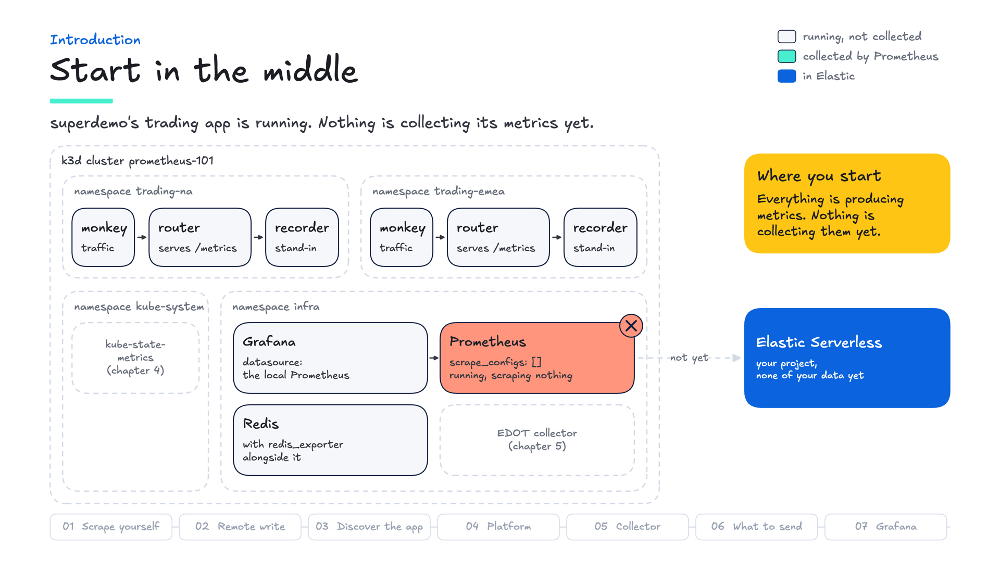

# Prometheus 101

A hands-on Prometheus workshop, and an on-ramp to [**superdemo**](https://github.com/ty-elastic/superdemo).

superdemo shows what Prometheus metrics in Elastic can do. This workshop builds the same pieces by hand, one chapter at a time, so you understand each one well enough to explain it to a customer, answer the technical follow-up questions, and change the setup to fit their environment.

You start with a Prometheus config that does nothing:

```yaml
scrape_configs: []
```

Seven chapters later you have superdemo's trading app, its Redis exporter, kube-state-metrics and an EDOT collector all discovered automatically, their metrics in Elastic Serverless via remote write, filtered at the scrape and at remote write, and Grafana and Kibana running the same PromQL against Elastic.

The app and its layout come from superdemo: its `router` service, namespaces, ports, `build.sh` idiom, remote write endpoint and data stream. So when you open superdemo afterwards, its Prometheus setup will look familiar.

**About an hour of hands-on work**, assuming setup is done in advance, or the eight walkthrough videos on their own.

---

## Why this workshop

Most of your Kubernetes customers already run Prometheus. It is the default for Kubernetes metrics: an open format, hundreds of exporters, and a query language, PromQL, that their engineers already know. What they struggle with is everything around it: keeping data longer than one server's disk allows (15 days by default), seeing across clusters, putting metrics next to logs and traces, and controlling what it all costs.

Elastic answers those without asking them to give anything up. Prometheus keeps scraping, remote write adds Elastic as a destination, and the same PromQL runs in Kibana and in their existing Grafana.

Each chapter teaches one Prometheus skill hands-on, shows the same query in Kibana, and ends with what to say to a customer, what to ask, and how to answer the usual objection. [`docs/FIELD-GUIDE.md`](docs/FIELD-GUIDE.md) collects all of it, with a five-minute demo you can run at the end.

---

## Get started

You need macOS or Linux, `docker`, `k3d`, `kubectl`, `jq`, `curl`, `git`, `make`, `helm` (chapter 04 installs kube-state-metrics from its chart), and an **Elastic Serverless** project. Roughly 3 GB of RAM for the cluster.

```bash
brew install k3d kubectl jq          # macOS; Docker Desktop for docker
brew install helm                    # chapter 04 installs kube-state-metrics with it
```

```bash
git clone https://github.com/ericmustin/prometheus-101-elastic
cd prometheus-101-elastic
```

```bash
cp .env.example .env
$EDITOR .env                         # ELASTIC_PROM_RW_ENDPOINT, ELASTIC_API_KEY, KIBANA_URL

make check                           # is this machine ready? prints your URLs
make setup                           # cluster, app, Prometheus (~3 min)

make chapter 1                       # start
```

Then open `chapters/01-scrape-yourself.md` and follow it.

Chapter 07 imports superdemo's own saved search, so clone it next to this repo before you get there:

```bash
git clone https://github.com/ty-elastic/superdemo ../superdemo
```

> `make check` prints the URLs you will actually use. The chapters are written with superdemo's port numbers — 9090 Prometheus, 9000/9001 the routers, 9012 Grafana — but if any of those were taken when you ran `make setup`, all four shifted by +20000. `make check` warns you when that has happened.

---

## Where you start

In the middle of the story. `make setup` builds superdemo's trading app the way you would find it on your first day: a `router` in each of two regions with a traffic generator hitting it, Redis with its exporter, and a Prometheus and a Grafana in `infra`.



```bash
kubectl get pods -A | grep -v kube-system
curl -s http://localhost:9000/metrics | grep '^shares_traded'
```

Everything is producing metrics, and nothing is collecting them: Prometheus runs with `scrape_configs: []`, and your Elastic project holds none of your data. Each chapter closes part of that gap with superdemo's own names, ports and files, and `docs/SUPERDEMO-MAP.md` shows at the end where every piece lives in superdemo.

---

## The loop

Every chapter is the same five steps.

```bash
make chapter 3                       # start chapter 3
make goals                           # what it asks of you: its checks, once, no waiting
$EDITOR prometheus/prometheus.yml    # make the change the chapter asks for
make apply                           # render, validate, push to the cluster
make test                            # grade it: waits for data, then decides
```

**▶ Your turn** in a chapter, or the same card in a video, marks a step to do on your own cluster.

Then `make chapter 4`, and so on. Stuck at any point:

```bash
make hint                            # what is still different from the solution
make answer                          # the exact change this chapter wants
make status                          # which chapter am I on?
```

`make` on its own lists everything.

### How it works

`solutions/NN/` holds the state you **start** chapter NN in — which is the same thing as the solution to chapter NN-1. `make chapter N` copies it into place; `make answer` diffs `solutions/N` against `solutions/N+1`. Your current chapter is a number in `.chapter`, which is gitignored.

Seven chapters, eight solution directories: `solutions/08` is the finished pipeline, so that chapter 07 has something to be compared against.

There are no branches. Editing `prometheus/prometheus.yml` and running `make chapter N` are the only two things that change your working tree, and `make chapter` saves your previous config into `.tmp/` before overwriting it.

---

## The seven chapters

| | Chapter | You learn | You break |
|---|---|---|---|
| 01 | Scrape yourself | targets, jobs, `up`, the exposition format | wrong port → target down |
| 02 | **Get it into Elastic** | remote write, `external_labels` | two failure modes, each in a different counter |
| 03 | Scrape the trading app | static targets, Kubernetes discovery, relabeling | RBAC first, then RE2 has no backreferences |
| 04 | Scrape the platform | kube-state-metrics, exporters, jobs as grouping | the chart annotates the Service, not the pod |
| 05 | Scrape the collector | `otelcol_*`, pull vs periodic readers | `send_failed` is absent, not zero, until a send fails |
| 06 | Choose what to send | filtering at the scrape vs at remote write, retention in Elastic | anchored regexes match nothing, silently |
| 07 | Grafana → Elastic | one datasource added; test the customer's dashboards | the API is a subset; exemplars do not port |

Each chapter starts with **Why it matters**: the customer's problem, what the chapter's Prometheus skill does about it, and why it is worth investing in. **Where you are** follows: a map of the cluster showing what is collected so far and what the chapter adds, and `make goals` listing its checks. Once the checks pass, **What you collect now** shows the same map with the chapter's work in place. Then **In the field**: what to say, what to ask, an objection and its answer, and where the piece lives in superdemo. **Explain it back** is the question you should now be able to answer for a customer.

You mostly edit `prometheus/prometheus.yml`. Chapter 03 also edits `k8s/router.yaml`; chapters 05 and 07 change no file at all, and in both cases that is the lesson.

---

## Looking at the data

From chapter 02 onward you query in **Kibana**: Discover, in ES|QL mode. PromQL runs there through the `PROMQL` command, so the queries are the ones a Prometheus user already writes:

```esql
PROMQL index=metrics-generic.prometheus-default step=1m
  sum by (region) (rate(http_requests_total[5m]))
```

`step=1m` draws a line over the date picker's range, like Prometheus's Graph tab; `time=?_tend` gives one answer at its end, like the Table tab. The Prometheus expression browser stays for chapter 01, and for questions about Prometheus itself.

```bash
make links                                               # every query, with a link that opens it in Discover
make esql Q=queries/esql/03-requests-by-region.esql      # or run one here and print a table
```

`queries/esql/*.esql` contain `${DATA_STREAM}`, which Kibana does not expand — so paste from `make links`, not from the files. `make links` needs `KIBANA_URL` in `.env`.

---

## Layout

```
prometheus/prometheus.yml   the file you edit
chapters/                   the course, one markdown file per chapter
solutions/NN/               each chapter's starting state
queries/esql/               the Kibana queries (ES|QL and PROMQL), by chapter
src/router/                 superdemo's router, vendored unmodified
k8s/                        envsubst templates: router, recorder, monkey
utils/                      redis, kube-state-metrics, prometheus + grafana
agents/apm/                 the EDOT collector
build.sh                    superdemo's deploy idiom; make wraps it
scripts/                    setup, apply, chapter switching, assertions
test/                       the grader
docs/FIELD-GUIDE.md         what to say, ask and demo: the course's field material in one place
docs/SUPERDEMO-MAP.md       what you built, and where it is in superdemo
docs/images/                the cluster maps and diagrams the chapters use, and video stills
```

---

## Troubleshooting

**`make apply` says promtool rejected the config** — the error names the line. Nothing was applied; your cluster is still on the previous config.

**`make apply` says promtool could not run** — that is Docker, not your YAML. Check `docker run --rm hello-world`.

**Prometheus is not where the chapter says** — your ports were shifted. `make check` prints the real ones.

**Pods will not start** — `kubectl get pods -A`. Workloads live in `trading-na`, `trading-emea` and `infra`.

**Chapter 02 says nothing is arriving** — `make test` names the failing check and diagnoses the failure mode. Do not trust `samples_failed_total` on its own; chapter 02 explains why.

**Start over** — `make clean && make setup`.

---

## Credits

The trading app and much of the deployment come from [superdemo](https://github.com/ty-elastic/superdemo). `src/router/`, `utils/redis/redis.yml`, `utils/ksm/ksm.sh` and `assets/scripts/retry.sh` are copied from it unmodified, and `build.sh`, `k8s/router.yaml` and `utils/prometheus-grafana/grafana.yaml` are adapted from it. See `NOTICE`.

The idea of a free, self-paced, hands-on Prometheus workshop comes from Eric D. Schabell's [Getting started with Prometheus](https://gitlab.com/o11y-workshops/workshop-prometheus) workshop from [o11y-workshops](https://gitlab.com/o11y-workshops). If you want Prometheus on its own, without Elastic, start there.

## License

[Apache License 2.0](LICENSE).
