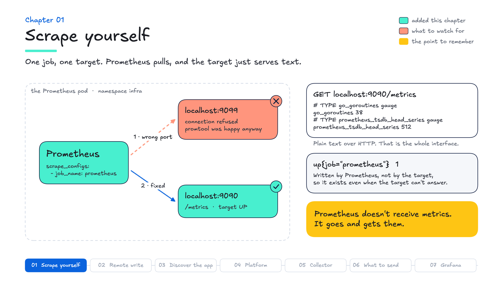

# Chapter 01 — Scrape yourself

**Goal:** get one target, any target, and understand what a "target" is.

## Why it matters

- **The problem:** every service needs a health signal and numbers you can trend, and teams want them without putting a vendor's agent in every app.
- **What Prometheus does:** the app serves plain text on `/metrics`, and Prometheus fetches it on a timer. The format is open and widely supported, so you instrument once and any tool that reads it can use it.
- **Why it's worth it:** this is why Prometheus is the default for Kubernetes metrics, and why most of your Kubernetes customers already run it. Their instrumentation, exporters and PromQL are an investment, and this course builds on that investment rather than replacing it.

---

## Where you are

`make setup` left everything running and nothing collected: Prometheus runs with an empty scrape list. This chapter gives it its first target, itself.


See what this chapter asks of you:

```bash
make goals
```

Three checks, all to do: a job, a healthy target, and samples stored. `make goals` runs each check once and doesn't wait; `make test`, at the end, waits for data before it decides.

---

## The idea

By default, Prometheus does not receive metrics. It goes and gets them.

No agent, no queue. There is a list of HTTP addresses in a config file, and on a fixed interval (15 seconds in this lab; Prometheus's default is a minute) Prometheus walks it, does a `GET /metrics` on each, and stores whatever comes back. Everything else in this course is elaboration on that loop. (Prometheus 3 can also accept pushed data, through remote write and OTLP receivers you switch on with a flag. This course uses the default: pull.)

Yours is running right now and doing nothing, because its config says:

```yaml
scrape_configs: []
```

---

## Do it wrong first

Prometheus exposes its own metrics on `/metrics`, like anything else it scrapes, so the first target is itself.

**▶ Your turn:** in `prometheus/prometheus.yml`, replace `scrape_configs: []` with this — the port is wrong on purpose:

```yaml
scrape_configs:
  - job_name: prometheus
    static_configs:
      - targets: ["localhost:9099"]
```

```bash
make apply
```

Open the Targets page (`make apply` prints its URL). One target, red, `connection refused`.

**Worth a pause.** The config is valid, Prometheus started fine, `promtool` was happy. The only thing telling you otherwise is this page, which is where to look first whenever a target's data is missing.

---

## Now do it right

**▶ Your turn:** change `9099` to `9090`, then `make apply`. The target goes green.

```promql
up
```

`1`. But `up` is not a metric the target produced — Prometheus **synthesises** it after every scrape. No target's `/metrics` ever contains `up`, which is exactly why it works for targets too broken to report anything about themselves.

*Why this shape:* `up == 0` is the first alert most teams write. It needs no instrumentation, and it covers every target the same way.

For about five minutes you will also see `up{instance="localhost:9099"}` at `0`: the broken target's last recorded scrape, before your fix. It drops out on its own.

Something the target really did produce:

```promql
prometheus_tsdb_head_series
```

Distinct series in memory. **Note roughly what it says**: chapter 06 comes back to it, after five chapters of targets have added to it.

*Why this shape:* the series count is what Prometheus's memory follows, and what any system storing these metrics is sized by.

And the raw text Prometheus parses:

```bash
curl -s http://localhost:9090/metrics | head -30
```

One line per series, `name{label="value"} number`. That format is the interface between Prometheus and everything it monitors, and no SDK is required: anything that serves it over HTTP with a `text/plain` (or OpenMetrics) `Content-Type` can be scraped. Prometheus 3 rejects a response with no `Content-Type` unless the job sets `fallback_scrape_protocol`.

You queried the Prometheus expression browser here because nothing has left this cluster yet. From chapter 02 on, the same PromQL runs in Kibana.

---

## Grade it

```bash
make test
```

Chapter 01's checks: the job exists, the target is up, samples are landing. The third matters: a config can parse and a target can be listed without a single sample ever being stored.

## What you collect now


## In the field

- **Say it:** "Prometheus pulls. Your app serves a page of numbers, Prometheus fetches it on a schedule, and `up` tells you the moment a target stops answering. No agent in the app."
- **Ask:** "How many Prometheus servers do you run, and who owns them?" and "How long do you keep the data, and what happens when someone needs last quarter's?"
- **If they say** "We already have Prometheus, why would we need anything else?": keep it. Ask what happens when a cluster's disk fills up, when someone needs to see across clusters, or when an incident needs data from before the retention window. Chapter 02 is the answer.
- **In superdemo:** its Prometheus config lives inside `utils/prometheus-grafana/grafana.yaml`, in the `prom-config` ConfigMap, and its Targets page is on port 9090, as here. When a demo shows no data, that page is the first place to look.

**Explain it back:** why does `up` still work for a target that is completely broken?

## What you now know



| | |
|---|---|
| **Prometheus server** | pulls over HTTP on a timer, stores locally |
| **Target** | one address that serves `/metrics` |
| **Job** | a named group of targets |
| **`up`** | synthesised per scrape; the first health signal to check |
| **Targets page** | where you find out what is actually broken |

Next: send it to Elastic, so the data outlives this cluster and you can query it in Kibana.
