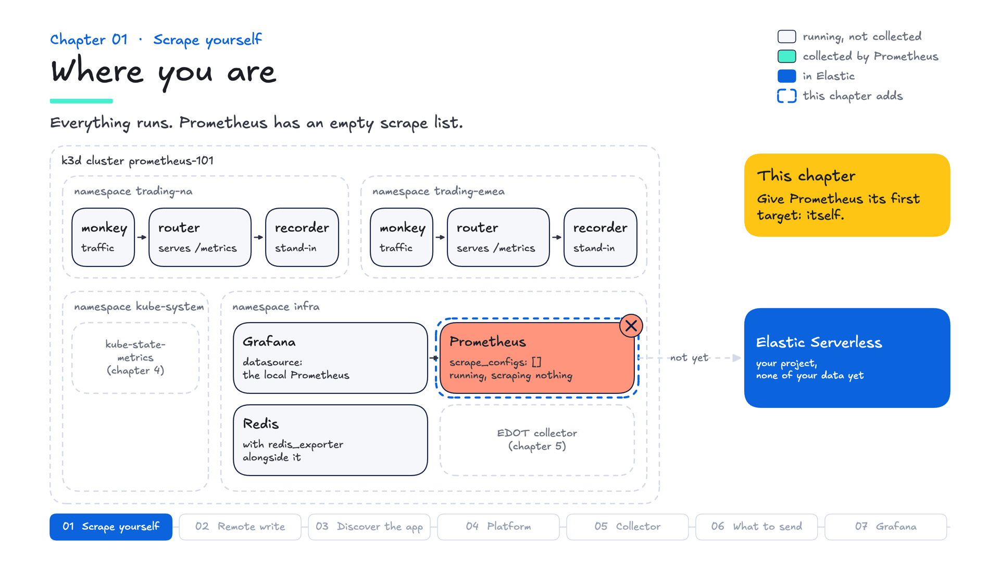
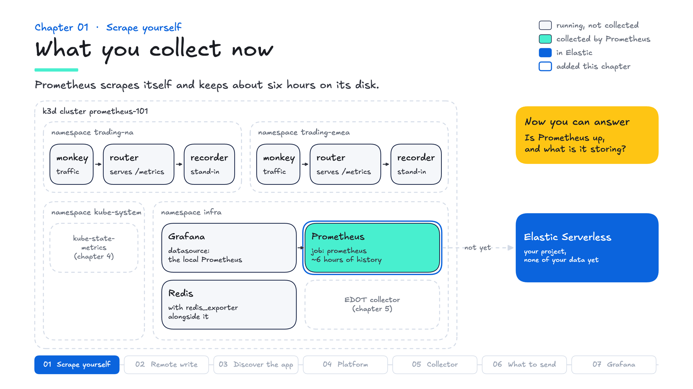

# Chapter 01 — Scrape yourself

**Goal:** give Prometheus its first target, itself, and watch it go green.

**Time:** 5 minutes

## Why it matters

Prometheus pulls. An app serves plain text on `/metrics`, and Prometheus fetches it on a timer, with no agent in the app. That open, simple contract is why Prometheus is the default for Kubernetes metrics, and why most of your Kubernetes customers already run it.



## Steps at a glance

1. Start the chapter: `make chapter 1`
2. Add a `prometheus` job to `prometheus/prometheus.yml`
3. Apply it: `make apply`
4. See it: the Targets page, then `up` on the Query page
5. Grade it: `make test`

## Step 1 · Start the chapter

```bash
make chapter 1
```

Prometheus is running, and its config gives it nothing to scrape:

```yaml
scrape_configs: []
```

## Step 2 · Add a scrape job

Prometheus serves its own metrics on port 9090, so its first target is itself. In `prometheus/prometheus.yml`, replace `scrape_configs: []` with:

```yaml
scrape_configs:
  - job_name: prometheus
    static_configs:
      - targets: ["localhost:9090"]
```

A **job** is a named group of targets. A **target** is one address that serves `/metrics`. Every 15 seconds Prometheus fetches each target and stores what comes back.

## Step 3 · Apply it

```bash
make apply
```

`make apply` checks the file with `promtool`, pushes it to the cluster and restarts Prometheus, which takes about half a minute. It prints the Targets page URL when it is done.

<details>
<summary>Note · If <code>make apply</code> says promtool rejected the config</summary>

The error names the line, and nothing was applied, so the cluster is still running the previous config. The usual cause is indentation: `- job_name` sits two spaces in from `scrape_configs:`.

</details>

## Step 4 · See it

Open the Targets page. There is one target, `localhost:9090`, and it is **UP**.

Then open the Query page and run:

```promql
up
```

You should see `1`. Prometheus writes `up` itself after every scrape: `1` if the scrape worked, `0` if it didn't. No target serves it, so it works even for a target too broken to answer, which is why `up == 0` is the first alert most teams write.

<details>
<summary>Note · If the target is red</summary>

Change the port to `9099`, `make apply`, and the Targets page shows the target **DOWN** with `connection refused`. The config is still valid and `promtool` passes it: only this page shows the problem. When a target's data is missing, look here first.

The broken target's last scrapes stay visible as `up{instance="localhost:9099"} 0` for about five minutes after you fix it, then age out.

</details>

<details>
<summary>Note · What Prometheus actually reads</summary>

```bash
curl -s http://localhost:9090/metrics | head -30
```

There is one line per series, `name{label="value"} number`. That text is the whole interface between Prometheus and what it monitors. Anything that serves it over HTTP with a `text/plain` (or OpenMetrics) `Content-Type` can be scraped, with no SDK required. Prometheus 3 rejects a response with no `Content-Type` unless the job sets `fallback_scrape_protocol`.

</details>

<details>
<summary>Note · How many series Prometheus holds</summary>

```promql
prometheus_tsdb_head_series
```

This counts the distinct series in memory. Prometheus's memory follows it, and so does any system that stores these metrics. Chapter 06 looks at where series come from, per job.

</details>

<details>
<summary>Note · Pull is the default, not the only way</summary>

Prometheus 3 can also accept pushed data, through remote write and OTLP receivers that you switch on with a flag. This course uses the default, pull.

</details>

## Step 5 · Grade it

```bash
make test
```

You should see `3 passed, 0 failed`: the job exists, its target is up, and samples are being stored.

## The whole change

In `prometheus/prometheus.yml`:

```yaml
scrape_configs:
  - job_name: prometheus
    static_configs:
      - targets: ["localhost:9090"]
```

The commands, in order:

```bash
make chapter 1
make apply
make test
```

## Say it

"Prometheus pulls. Your app serves a page of numbers, Prometheus fetches it on a schedule, and `up` tells you the moment a target stops answering. No agent in the app."



<details>
<summary>Note · In the field</summary>

- **Ask:** "How many Prometheus servers do you run, and who owns them?" and "How long do you keep the data, and what happens when someone needs last quarter's?"
- **If they say** "We already have Prometheus, why would we need anything else?": keep it. Ask what happens when a cluster's disk fills up, when someone needs to see across clusters, or when an incident needs data from before the retention window. Chapter 02 is the answer.
- **In superdemo:** its Prometheus config lives in `utils/prometheus-grafana/grafana.yaml`, in the `prom-config` ConfigMap, and its Targets page is on port 9090, as here. When a demo shows no data, that page is the first place to look.

</details>

Next: send these metrics to Elastic, so they outlive the cluster and you can query them in Kibana.
