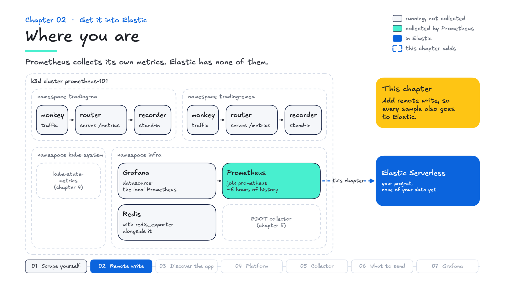
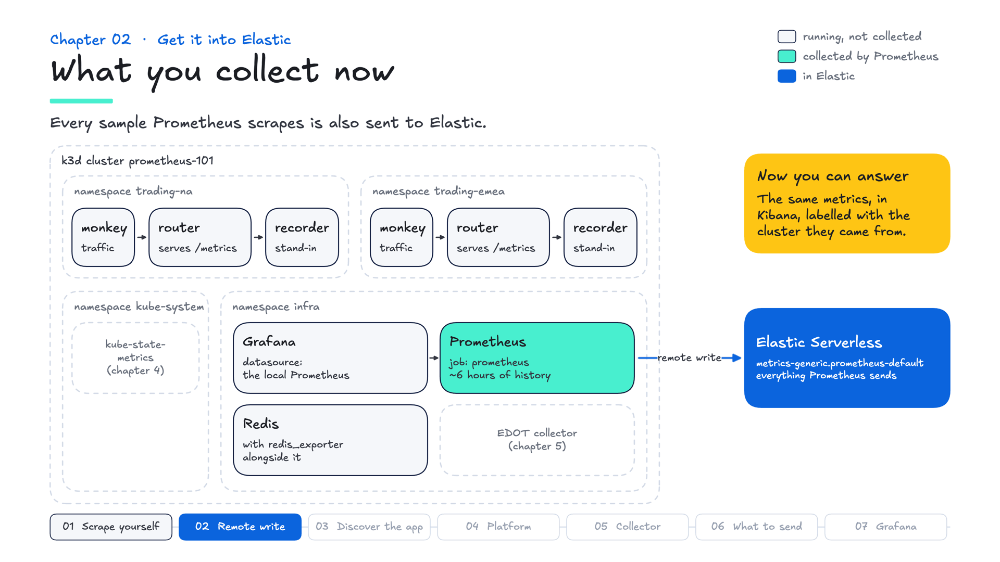

# Chapter 02 — Get it into Elastic

**Goal:** get metrics out of the cluster on your second edit, so Kibana — not the Prometheus expression browser — is where you spend the rest of the course.

---

## Where you are

Prometheus scrapes itself and keeps about six hours of history on its own disk. Your Elastic project has none of it. This chapter adds remote write, so every sample is also sent to Elastic.



Grade it before you start:

```bash
make test
```

Chapter 01 passes. Chapter 02's checks fail: there is no `remote_write` block, so nothing is delivered and nothing has landed. The delivery check waits a few minutes before it gives up.

---

## Why now

This lab's Prometheus keeps 6 hours on one disk (the default is 15 days), cannot be queried across clusters, and holds metrics apart from logs and traces. **Remote write** streams every sample to an HTTP endpoint alongside the local disk. Nothing about scraping changes.

Elasticsearch speaks the protocol natively — no collector, no agent, no conversion:

```
https://<your-elasticsearch>/_prometheus/api/v1/write
```

> **For production on Serverless or Elastic Cloud Hosted**, Elastic recommends its managed Prometheus remote write endpoint (a managed input) over writing to Elasticsearch directly. This course writes to Elasticsearch's `_prometheus` endpoint, as superdemo does. Through the managed endpoint you route with the `data_stream_dataset` and `data_stream_namespace` labels rather than the URL path, and a success response means accepted for processing, not yet indexed.

superdemo's URL, with **no routing segments** — it lands in `metrics-generic.prometheus-default`, which is why superdemo's Grafana datasource and saved search work against your data unmodified. The path can also route explicitly:

```
/_prometheus/metrics/<dataset>/<namespace>/api/v1/write
  -> metrics-<dataset>.prometheus-<namespace>
```

`generic` works well for one cluster. With a second, route each cluster to its own data stream, so you can tell them apart and set retention separately. Yours:

```bash
make check | grep "Data stream"
```

---

## Do it wrong first

Add a `remote_write` block with no credentials:

```yaml
remote_write:
  - name: elastic
    url: "${ELASTIC_PROM_RW_ENDPOINT}"
```

`make apply` substitutes `${ELASTIC_PROM_RW_ENDPOINT}` — Prometheus does not expand environment variables itself.

```bash
make apply
```

The Targets page stays green: remote write is a **separate pipeline** with separate failure modes, and that page knows nothing about it.

```promql
prometheus_remote_storage_samples_failed_total
```

**Climbing**: a failure this counter shows. Elasticsearch returns 401, which Prometheus treats as **non-recoverable**: it drops the batch and counts it.

Now the part worth slowing down for:

```promql
time() - prometheus_remote_storage_queue_highest_sent_timestamp_seconds
```

**About 20 seconds** — reads as "all is well" while **100% of your samples are being rejected**. Prometheus advances that clock when it *finishes with* a batch, and giving up counts as finishing.

### Break it the other way

```yaml
    authorization:
      type: ApiKey
      credentials_file: /etc/elastic/does-not-exist
```

`make apply`, wait a minute:

```promql
prometheus_remote_storage_samples_failed_total    # 0
prometheus_remote_storage_samples_retried_total   # 11,860 and climbing
```

**Zero failures, nothing delivered.** Prometheus treats this error as *retryable*, and a retried sample is not counted in `samples_failed_total`.

> Measured on this stack: with the credentials file absent, `samples_failed_total` stayed at **0 through 150,573 retries**.

### The two modes are complementary

Both measured here, not quoted from documentation:

| | **401** (no auth) | **credentials file missing** |
|---|---|---|
| Prometheus calls it | non-recoverable | retryable |
| `..._samples_failed_total` | 2,512 | **0** ← looks healthy |
| `..._samples_retried_total` | 0 | 11,860 |
| `..._queue_highest_sent_timestamp_seconds` | **advancing** ← looks healthy | 0 |

**No single counter means "remote write is working."** Watch failures and you miss the retry loop; watch time-since-last-send and you miss outright rejection. The grader asks both, then checks the destination: data arriving in Elastic is the most direct evidence.

---

## Now do it properly

Add `external_labels` under the `global:` block you already have, and replace your `remote_write` block with this one:

```yaml
global:
  external_labels:
    cluster: prometheus-101
    env: lab

remote_write:
  - name: elastic
    url: "${ELASTIC_PROM_RW_ENDPOINT}"
    authorization:
      type: ApiKey
      credentials_file: /etc/elastic/api-key
    queue_config:
      capacity: 2500
      max_shards: 4
      min_shards: 1
      max_samples_per_send: 500
      batch_send_deadline: 5s
```

```bash
make apply
```

**`credentials_file`, not `credentials`** — this becomes a ConfigMap, and a ConfigMap is plaintext to anyone with `kubectl`. `make apply` refuses to ship a pasted key.

**`external_labels`** are stamped on the way out and do not exist locally. Without them, every series is anonymous once it lands: one cluster's data looks like any other's.

**`queue_config`** is the shock absorber; `samples_pending` tells you when to tune it.

---

## A burst of errors you may see

`make logs` may show this within a minute or two of the change:

```
400 Bad Request: ... 468 of 500 samples failed.
VersionConflictEngineException: version conflict, document already exists
```

If it does, it is one-time. Elasticsearch stores remote write in a **time series data stream**, which deduplicates, so a retried batch that re-sends samples that already landed is rejected. A clean first run often shows nothing at all, and newer Elasticsearch releases drop duplicates silently instead of returning an error.

```promql
rate(prometheus_remote_storage_samples_failed_total[2m])
```

Back to zero and stays there. **Alert on the rate, not the total**: the total stays raised after a burst (until the next restart resets it), while the rate returns to zero.

---

## Now move to Kibana

```bash
make esql Q=queries/esql/01-landed.esql
```

```
    samples    |    regions    |   services
---------------+---------------+---------------
4776           |0              |0
```

Your sample count will differ; the other two will not. `regions` and `services` are **zero** because nothing has attached those labels — the only thing being scraped is Prometheus itself. Chapter 03 is where they stop being zero. (Not zero? If you finished an earlier run of the course in the last 15 minutes, its data is still in the window.)

```bash
make links
```

Every course query, ready to paste, plus a link that opens it already typed. Keep the editor open — from here on, check things in Kibana unless the question is about Prometheus's own internals.

### The field model

```bash
make esql Q=queries/esql/02-metrics-info.esql
```

**Values go under `metrics.`, labels under `labels.`**, and Elasticsearch infers metric type from the name suffix — `_total`, `_sum`, `_count`, `_bucket` mean counter, everything else gauge. The naming convention is not style; a downstream system reads it.

That shape belongs to *the path*, not the app: the same counter sent over OTLP lands in the OpenTelemetry field model instead, with its label under `attributes.symbol`. Which is why "we support Prometheus" needs a follow-up — which Prometheus? A scrape source, a collector input, a wire protocol, a field shape, or a query language.

---

## Grade it

```bash
make test
```

Chapter 02's checks: the running config has a `remote_write` block, the key is read from a file, remote write is delivering by both measures, data is queryable in your data stream, and documents carry `labels.cluster` from `external_labels`.

## What you collect now



## In the field

- **In superdemo:** its Prometheus remote-writes to the same `_prometheus/api/v1/write` URL, into `metrics-generic.prometheus-default`, so the queries you ran here work against a running superdemo.
- **What customers ask:** "Do we have to replace Prometheus?" No. Remote write adds a destination: local scraping, rules and alerts keep working, and Elastic adds longer retention, queries across clusters, and metrics next to logs and traces.
- **Good practice:** label each cluster with `external_labels`, route clusters or teams to their own data streams (the `/_prometheus/metrics/<dataset>/<namespace>` path here, or the `data_stream_dataset` and `data_stream_namespace` labels through the managed endpoint), keep the API key in a Secret, and watch remote write with both the failure and the lag signals.

## What you now know


| | |
|---|---|
| **Remote write** | a second, asynchronous pipeline with its own failure modes |
| **`_prometheus/metrics/<dataset>/<namespace>`** | path routing → data stream name |
| **`credentials_file`** | keys come from Secrets; ConfigMaps are plaintext |
| **`external_labels`** | stamped on the way out; how you tell clusters apart |
| **The self-metrics** | two failure modes, each in a different counter |
| **A conflict burst** | possible once, from a retried batch; alert on rate, not total |
| **`metrics.` / `labels.`** | the Prometheus field shape in Elasticsearch |

Next: scrape the trading app, and let Kubernetes tell Prometheus where it is.
