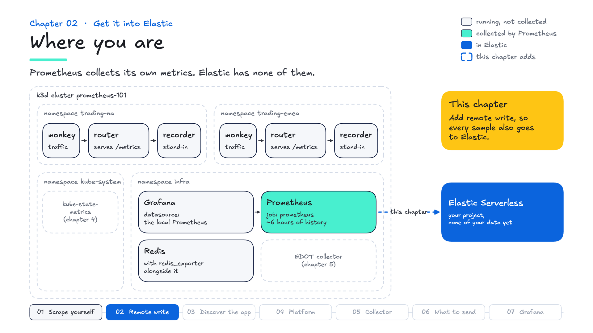
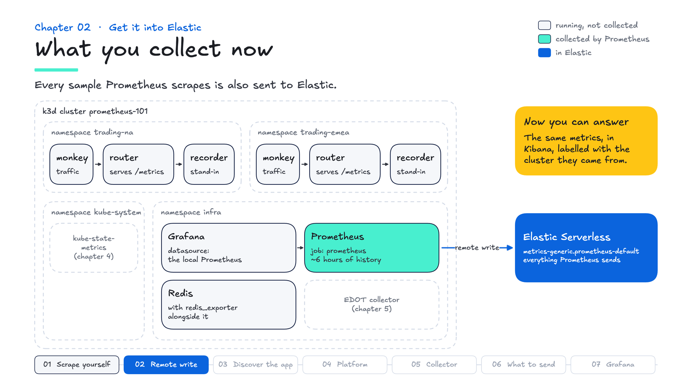

# Chapter 02 — Get it into Elastic

**Goal:** send every sample to Elastic with remote write, and run your first PromQL query in Kibana.

**Time:** 8 minutes

## Why it matters

A Prometheus server keeps its data on one disk, for one cluster: 15 days by default, 6 hours in this lab. Remote write streams every sample to Elastic as it is scraped, so the customer keeps the Prometheus they have, adds one block of config, and gets longer history and one view across clusters, queried with the PromQL they already write.



## Steps at a glance

1. Start the chapter: `make chapter 2`
2. Label the cluster: `external_labels` under `global:`
3. Add a `remote_write` block that points at Elastic
4. Apply it: `make apply`
5. See it: one PromQL query in Kibana
6. Grade it: `make test`

## Step 1 · Start the chapter

```bash
make chapter 2
```

## Step 2 · Label the cluster

In `prometheus/prometheus.yml`, add `external_labels` under the `global:` block that is already there:

```yaml
global:
  external_labels:
    cluster: prometheus-101
    env: lab
```

`external_labels` are stamped onto every series on the way out. Once the data lands in Elastic, they are how you tell one cluster's data from another's.

## Step 3 · Add remote write

At the bottom of the file, add:

```yaml
remote_write:
  - name: elastic
    url: "${ELASTIC_PROM_RW_ENDPOINT}"
    authorization:
      type: ApiKey
      credentials_file: /etc/elastic/api-key
    queue_config:
      capacity: 2500
      max_shards: 4
      min_shards: 1
      max_samples_per_send: 500
      batch_send_deadline: 5s
```

What each part does:

- **`url`**: Elasticsearch's own remote write endpoint, from your `.env`. `make apply` fills it in, because Prometheus does not expand environment variables itself.
- **`credentials_file`**: the API key is read from a file that `make setup` mounted from a Secret. The config becomes a ConfigMap, which anyone with `kubectl` can read, so the key never goes in it.
- **`queue_config`**: the buffer between scraping and sending.

<details>
<summary>Note · The endpoint, and which data stream it writes to</summary>

Elasticsearch accepts remote write natively, with no collector or agent in between:

```
https://<your-elasticsearch>/_prometheus/api/v1/write
```

This URL has no routing segments, so data lands in `metrics-generic.prometheus-default`, as it does in superdemo. That is why superdemo's Grafana datasource and saved search work against your data unchanged. The path can also route explicitly:

```
/_prometheus/metrics/<dataset>/<namespace>/api/v1/write
  -> metrics-<dataset>.prometheus-<namespace>
```

Tell clusters apart with a label (`external_labels`), and give teams their own data streams when they need different retention or ownership. Yours: `make check | grep "Data stream"`.

**For production on Serverless or Elastic Cloud Hosted**, Elastic recommends its managed Prometheus remote write endpoint (a managed input) over writing to Elasticsearch directly. Through it you route with the `data_stream_dataset` and `data_stream_namespace` labels rather than the URL path, and a success response means accepted for processing, not yet indexed.

</details>

<details>
<summary>Note · Tuning the queue</summary>

`queue_config` absorbs a slow or rate-limiting receiver. `prometheus_remote_storage_samples_pending` tells you when to tune it: if it keeps growing, Prometheus is scraping faster than it can send.

</details>

## Step 4 · Apply it

```bash
make apply
```

The Targets page doesn't change. Remote write is a separate pipeline, and that page knows nothing about it, so you check delivery in Elastic.

## Step 5 · See it in Kibana

Open Kibana → **Discover**, switch the query bar to **ES|QL**, and run:

```esql
PROMQL index=metrics-generic.prometheus-default time=?_tend
  count by (cluster, env) (up)
```

You should see one row: `prometheus-101`, `lab`. Those are the labels you stamped in Step 2, now a dimension you can group by. In an estate with twenty clusters there is a row per cluster, and a row that disappears is a cluster that stopped sending.

`PROMQL` runs PromQL in Kibana. `time=?_tend` gives one answer at the end of the date picker's range, like Prometheus's Table tab; `step=1m` gives a line across the range, like its Graph tab. A one-answer query has nothing to chart, so Discover's chart reads "No results found" above a full table. That is expected.

To skip the typing, `make links` prints a link for each of this chapter's queries that opens it in Discover, ready to run.

<details>
<summary>Note · If nothing arrives: the two ways remote write fails</summary>

Remote write fails in two ways, and each one hides from a different counter. Both were measured on this stack:

| | **401** (no `authorization` block) | **credentials file missing** |
|---|---|---|
| Prometheus calls it | non-recoverable: drops the batch | retryable: tries again |
| `prometheus_remote_storage_samples_failed_total` | climbing | **0** ← looks healthy |
| `prometheus_remote_storage_samples_retried_total` | 0 | climbing |
| `time() - prometheus_remote_storage_queue_highest_sent_timestamp_seconds` | **~20s** ← looks healthy | growing |

No single counter means "remote write is working". Watch failures and you miss the retry loop; watch time since the last send and you miss outright rejection, because giving up on a batch counts as finishing with it. Check both in the Prometheus expression browser, then check the destination: data arriving in Elastic is the most direct evidence. Elastic can't see a pipe that isn't delivering, so a broken remote write is debugged at the source. `make test` asks both questions and names the failure mode.

</details>

<details>
<summary>Note · A burst of 400 errors after the change</summary>

`make logs` may show this within a minute or two:

```
400 Bad Request: ... 468 of 500 samples failed.
VersionConflictEngineException: version conflict, document already exists
```

It is one-time. Elasticsearch stores remote write in a time series data stream, which deduplicates, so a retried batch that re-sends samples that already landed is rejected. A clean first run often shows nothing, and newer Elasticsearch releases drop duplicates silently. Alert on the rate, which returns to zero, not the total, which stays raised until the next restart:

```esql
PROMQL index=metrics-generic.prometheus-default step=1m
  rate(prometheus_remote_storage_samples_failed_total[2m])
```

</details>

<details>
<summary>Note · What remote write creates in Elasticsearch</summary>

Every metric that landed, charted, with no query at all:

```esql
TS metrics-generic.prometheus-default
```

The field model is in `make esql Q=queries/esql/02-field-model.esql`. Values go under `metrics.` and labels under `labels.`. Elasticsearch infers the metric type from the name suffix: `_total`, `_sum`, `_count` and `_bucket` mean counter, and everything else is a gauge. PromQL in Kibana hides the prefixes, so you write `up`, not `metrics.up`.

That shape belongs to the path, not the app. The same counter sent over OTLP lands in the OpenTelemetry field model, with its label under `attributes.`. So "we support Prometheus" needs a follow-up question: a scrape source, a collector input, a wire protocol, a field shape, or a query language?

</details>

## Step 6 · Grade it

```bash
make test
```

You should see every check pass: remote write configured with the key read from a file, delivering by both measures, and your data in Elastic carrying `labels.cluster`.

## The whole change

In `prometheus/prometheus.yml`, under `global:`:

```yaml
  external_labels:
    cluster: prometheus-101
    env: lab
```

At the bottom of the file:

```yaml
remote_write:
  - name: elastic
    url: "${ELASTIC_PROM_RW_ENDPOINT}"
    authorization:
      type: ApiKey
      credentials_file: /etc/elastic/api-key
    queue_config:
      capacity: 2500
      max_shards: 4
      min_shards: 1
      max_samples_per_send: 500
      batch_send_deadline: 5s
```

The commands, in order:

```bash
make chapter 2
make apply
make test
```

## Say it

"Keep your Prometheus. Add one `remote_write` block and every sample also goes to Elastic, kept as long as you choose and queried with the PromQL you already write."



<details>
<summary>Note · In the field</summary>

- **Ask:** "How many clusters do you run, and how do you see across them today?" and "How would you know if one of them stopped sending metrics?"
- **If they say** "We already run Thanos (or Mimir) for that": then they know why central storage matters. Ask what running it costs in people and infrastructure, and how they get from a metric to the logs behind it today. Elastic keeps metrics, logs and traces in one place, queried with PromQL or ES|QL.
- **Good practice:** label each cluster with `external_labels`, route teams with different retention needs to their own data streams, keep the API key in a Secret, and watch remote write with both the failure and the lag signals.
- **In superdemo:** its Prometheus remote-writes to the same `_prometheus/api/v1/write` URL, into `metrics-generic.prometheus-default`, so the queries you ran here work against a running superdemo.

</details>

Next: scrape the trading app, and let Kubernetes tell Prometheus where it is.
