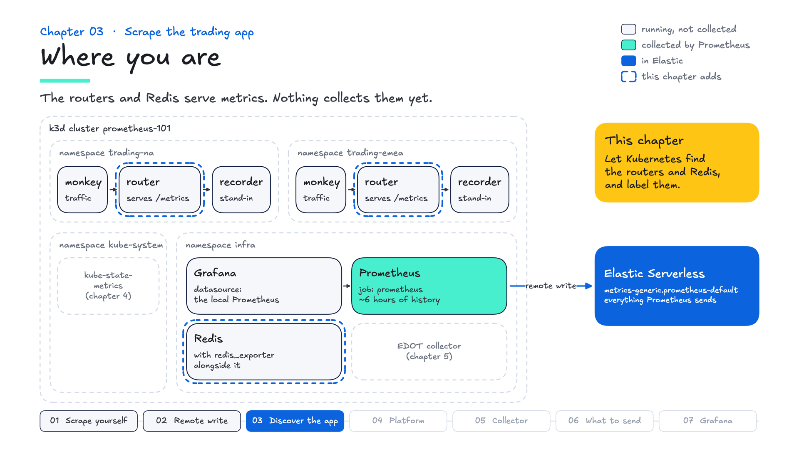
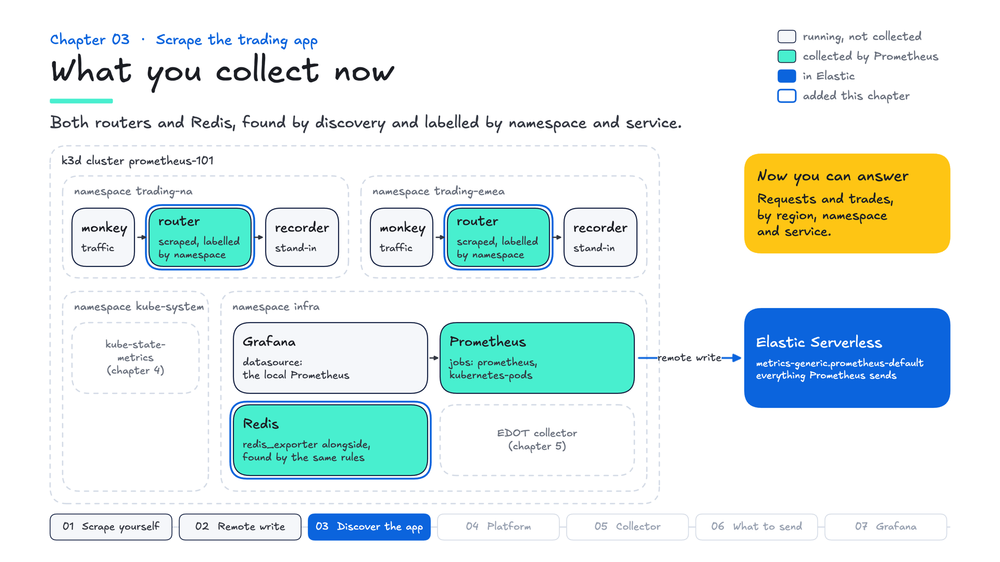

# Chapter 03 — Scrape the trading app

**Goal:** let Kubernetes tell Prometheus what to scrape, label every series with where it runs, and ask the golden-signal questions in Kibana.

**Time:** 12 minutes

## Why it matters

A metric is only as useful as its labels: "requests per second in EMEA, for the router" helps, "requests per second" doesn't. Kubernetes discovery finds every pod that asks to be scraped, and relabeling turns what Kubernetes knows into labels, so new services are covered without a ticket and one dashboard works for every region.



## Steps at a glance

1. Start the chapter: `make chapter 3`
2. Let Prometheus list pods: `kubectl apply -f utils/prometheus-grafana/rbac.yml`
3. Mark the router for scraping: two annotations in `k8s/router.yaml`, then `./build.sh -s router`
4. Add the `kubernetes-pods` discovery job to `prometheus/prometheus.yml`
5. Apply it: `make apply`, then check the Targets page
6. See it: where every target runs, in Kibana
7. Ask the golden-signal questions: rate and latency per region
8. Grade it: `make test`

## Step 1 · Start the chapter

```bash
make chapter 3
```

## Step 2 · Let Prometheus list pods

Discovery asks the Kubernetes API for pods, and Prometheus's ServiceAccount needs permission to ask. This file grants it read access to pods, services, endpoints and nodes:

```bash
kubectl apply -f utils/prometheus-grafana/rbac.yml
```

<details>
<summary>Note · If you skip this step</summary>

Prometheus shows no targets for the job: not red, absent. The reason is in its log:

```bash
make logs | grep -i forbidden
```

```
pods is forbidden: User "system:serviceaccount:infra:prometheus"
cannot list resource "pods" in API group "" in the namespace "trading-na"
```

Apply the RBAC file and the targets appear within half a minute, with no restart, because Prometheus keeps retrying. In a customer's cluster the fix is the same kind of ClusterRole and binding, or the one their Helm chart creates.

</details>

## Step 3 · Mark the router for scraping

The workload declares how it should be scraped. In `k8s/router.yaml`, under the pod template's `metadata:` (`spec.template.metadata`), next to its `labels:`, add:

```yaml
      annotations:
        prometheus.io/scrape: "true"
        prometheus.io/port: "9000"
```

Then redeploy the router:

```bash
./build.sh -s router
```

These are two lines, owned by the team that knows which port serves metrics. Whoever runs Prometheus doesn't have to know.

## Step 4 · Add the discovery job

In `prometheus/prometheus.yml`, add this job below the `prometheus` job:

```yaml
  - job_name: kubernetes-pods
    kubernetes_sd_configs:
      - role: pod
        namespaces:
          names: ["trading-na", "trading-emea", "infra"]

    relabel_configs:
      - source_labels: [__meta_kubernetes_pod_annotation_prometheus_io_scrape]
        action: keep
        regex: "true"

      - source_labels: [__address__, __meta_kubernetes_pod_annotation_prometheus_io_port]
        action: replace
        regex: ([^:]+)(?::\d+)?;(\d+)
        replacement: $1:$2
        target_label: __address__

      - source_labels: [__meta_kubernetes_pod_annotation_prometheus_io_path]
        action: replace
        target_label: __metrics_path__
        regex: (.+)

      - source_labels: [__meta_kubernetes_namespace]
        target_label: namespace
      - source_labels: [__meta_kubernetes_pod_name]
        target_label: pod
      - source_labels: [__meta_kubernetes_pod_label_service]
        target_label: service
      - source_labels: [__meta_kubernetes_pod_node_name]
        target_label: node
```

Discovery turns every pod in those namespaces into a candidate target, carrying `__meta_kubernetes_*` labels. Relabeling then runs top to bottom:

| Rule | What it does |
|---|---|
| `keep` on the scrape annotation | drops every pod that has not opted in |
| rewrite `__address__` | scrapes the port the annotation names |
| `__metrics_path__` | honours a custom path if a pod sets one; `/metrics` otherwise |
| the last four | copy discovery metadata into labels you can query: `namespace`, `pod`, `service`, `node` |

<details>
<summary>Note · Why not just list the targets?</summary>

You can name them, and it is the quickest start. This is the same list superdemo's Prometheus scrapes:

```yaml
  - job_name: trading-app
    static_configs:
      - targets:
        - router.trading-na.svc.cluster.local:9000
        - router.trading-emea.svc.cluster.local:9000
        - redis-service.infra.svc.cluster.local:9000
```

Named targets carry only `job` and `instance`. Every new service is an edit to this file, and any label you want, a namespace or a region, you add and keep correct by hand. That is fine at three targets and a maintenance job at thirty. Discovery is how that list grows on its own.

</details>

<details>
<summary>Note · One target per port, and no backreferences</summary>

`role: pod` produces one candidate per **declared container port**, so a pod that declares two ports gives two candidates. The obvious fix, keeping the candidate whose port matches the annotation, needs a backreference:

```yaml
        regex: (\d+);\1          # rejected
```

Prometheus regexes are RE2, which has no backreferences, so `make apply` stops at `promtool`: ``invalid escape sequence: `\1` ``. Rule 2 sidesteps it. Rewriting `__address__` from the annotation makes every candidate for a pod identical, and Prometheus deduplicates identical targets.

</details>

<details>
<summary>Note · Where the pod's other labels go</summary>

Anything still starting with `__` is dropped once relabeling finishes. That is why the pod's other labels, `pod_template_hash` among them, never reach your series: you choose what becomes a label. The `labelmap` shortcut would import every pod label, including `pod_template_hash`, which changes on every deploy and multiplies series.

</details>

## Step 5 · Apply it

```bash
make apply
```

You should see the `kubernetes-pods` job on the Targets page with three targets, all **UP**: the router in `trading-na`, the router in `trading-emea`, and Redis in `infra`.

Nothing in the job names Redis. Its manifest, `utils/redis/redis.yml`, already carries the two annotations, so the same rules found it. That is what discovery buys you: chapter 05's collector is found the same way.

## Step 6 · See where everything runs

In Kibana:

```esql
PROMQL index=metrics-generic.prometheus-default time=?_tend
  count by (namespace, service) (up)
```

You should see:

```
count by (namespace, service) (up) | namespace    | service
1.0                                | trading-emea | router
1.0                                | trading-na   | router
1.0                                | infra        | null
1.0                                | null         | null
```

Each target is labelled with the namespace it runs in. `infra` with no service is Redis, whose pod has no `service` label, and the row with neither is Prometheus scraping itself. `count by` the labels you care about is the inventory pattern.

<details>
<summary>Note · The same labels, as documents</summary>

```bash
make esql Q=queries/esql/03-identity.esql
```

```
labels.cluster |  labels.env   |labels.namespace|labels.service |      labels.pod       | labels.region
---------------+---------------+----------------+---------------+-----------------------+---------------
prometheus-101 |lab            |trading-na      |router         |router-c59f76fc6-k8rqx |na
```

`cluster` and `env` come from chapter 02's `external_labels`; `namespace`, `service` and `pod` from the rules you just wrote; `region` from the application. Your pod name will differ.

</details>

## Step 7 · Ask the golden-signal questions

Requests per second, per region:

```esql
PROMQL index=metrics-generic.prometheus-default step=1m
  sum by (region) (rate(http_requests_total[5m]))
```

The 95th-percentile latency, per region:

```esql
PROMQL index=metrics-generic.prometheus-default step=1m
  histogram_quantile(0.95, sum by (le, region) (rate(http_request_duration_seconds_bucket[5m])))
```

You should see two lines on each chart, `na` and `emea`. `rate()` turns a counter that only goes up into a per-second figure, `sum by (region)` adds up the pods behind each region, and the 95th percentile shows the slow requests an average hides. These are the Rate and Duration of **RED** (Rate, Errors, Duration), and they run unchanged in Prometheus and in Grafana.

<details>
<summary>Note · Errors, and absent versus zero</summary>

The same rate, split by status code:

```esql
PROMQL index=metrics-generic.prometheus-default step=1m
  sum by (region, status) (rate(http_requests_total[5m]))
```

Every line here is `200`. An error ratio divides the `5xx` rate by the total, and here it returns no result rather than 0, because no `5xx` series exists yet. Absent is not the same as zero, and an alert has to allow for it.

</details>

## Step 8 · Grade it

```bash
make test
```

You should see every check pass: both routers and Redis found by discovery, labelled with where they run, and those labels arriving in Elastic.

## The whole change

In `k8s/router.yaml`, under `spec.template.metadata`:

```yaml
      annotations:
        prometheus.io/scrape: "true"
        prometheus.io/port: "9000"
```

In `prometheus/prometheus.yml`, below the `prometheus` job:

```yaml
  - job_name: kubernetes-pods
    kubernetes_sd_configs:
      - role: pod
        namespaces:
          names: ["trading-na", "trading-emea", "infra"]

    relabel_configs:
      - source_labels: [__meta_kubernetes_pod_annotation_prometheus_io_scrape]
        action: keep
        regex: "true"

      - source_labels: [__address__, __meta_kubernetes_pod_annotation_prometheus_io_port]
        action: replace
        regex: ([^:]+)(?::\d+)?;(\d+)
        replacement: $1:$2
        target_label: __address__

      - source_labels: [__meta_kubernetes_pod_annotation_prometheus_io_path]
        action: replace
        target_label: __metrics_path__
        regex: (.+)

      - source_labels: [__meta_kubernetes_namespace]
        target_label: namespace
      - source_labels: [__meta_kubernetes_pod_name]
        target_label: pod
      - source_labels: [__meta_kubernetes_pod_label_service]
        target_label: service
      - source_labels: [__meta_kubernetes_pod_node_name]
        target_label: node
```

The commands, in order:

```bash
make chapter 3
kubectl apply -f utils/prometheus-grafana/rbac.yml
./build.sh -s router
make apply
make test
```

## Say it

"Your workloads declare how to be scraped, and Prometheus finds them. Every metric arrives labelled with where it came from, so the same dashboard works for every region and every new service."



<details>
<summary>Note · In the field</summary>

- **Ask:** "How does a new service get monitored today: a ticket, a config change, or automatically?" and "Do your teams use the same labels for the same things?"
- **If they say** "We use the Prometheus Operator": good. Its ServiceMonitor and PodMonitor resources do the job these annotations do here. Everything after discovery, the labels, remote write and PromQL, works the same.
- **Good practice:** labels become dimensions in Elastic (`labels.namespace`, `labels.service`), so choose them on purpose: enough to group and filter by, without per-request values that multiply series.
- **In superdemo:** its Prometheus names its three targets, as in the first note under Step 4. Discovery is how that setup grows: annotate a workload, and the same rules find it.

</details>

Next: cluster state, from kube-state-metrics.
