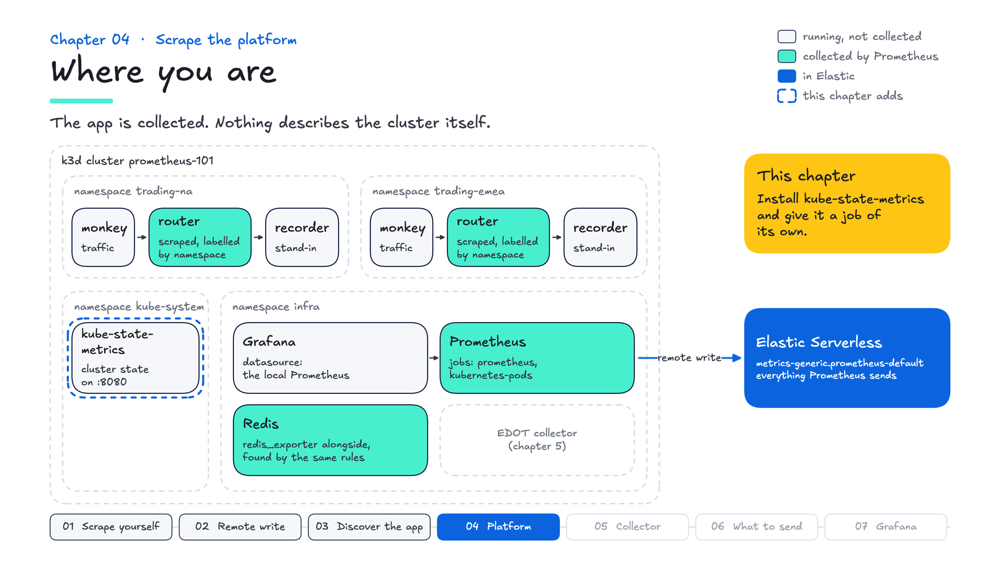
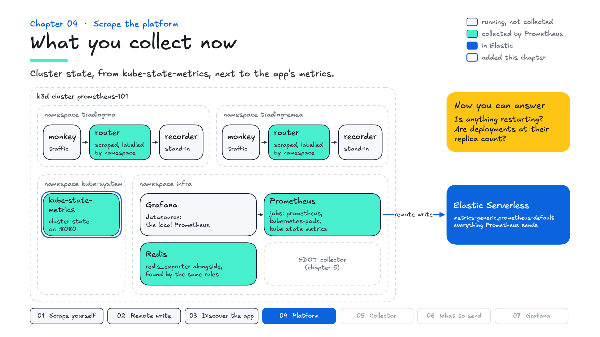

# Chapter 04 — Scrape the platform

**Goal:** collect cluster state with kube-state-metrics, and see why it needs a job of its own.

## Why it matters

- **The problem:** the first question in most incidents is "is it the app or the platform?" Application metrics can't answer it: they don't know a pod is crash-looping or a deployment is short of replicas.
- **What Prometheus does:** exporters translate other systems into the Prometheus format. kube-state-metrics does it for the Kubernetes API: pods, deployments, nodes, restarts.
- **Why it's worth it:** there are exporters for hundreds of systems (databases, queues, load balancers, hardware), which is much of why Prometheus became the standard. Cluster state lands next to the app's metrics, under the same labels, so one query can compare them.

---

## Where you are

Prometheus discovers the routers and Redis, and their metrics reach Elastic with Kubernetes labels. Nothing yet describes the cluster itself: which pods are running, whether deployments have their replicas, whether anything is restarting. This chapter installs kube-state-metrics and gives it a job.



```bash
make goals
```

Chapters 01 to 03 pass. Chapter 04's are to do, starting with installing kube-state-metrics.

---

## The idea

So far you have collected application metrics, which answer "is the service healthy". They do not answer "is the *cluster* healthy" — is anything crash-looping, are deployments at their replica count, is a pod stuck Pending.

That layer is what **exporters** are for: a process translating something into the Prometheus exposition format. You already met one without noticing — the `redis_exporter` sidecar that appeared for free in chapter 03.

For cluster state the standard is **kube-state-metrics**, one Helm install.

**▶ Your turn:**

```bash
make ksm
```

That runs `utils/ksm/ksm.sh`, the same script superdemo uses. Now check the Targets page.

**Nothing.** For the first time in three chapters, a new workload did *not* appear.

---

## Why discovery didn't find it

```bash
kubectl -n kube-system get pod -l app.kubernetes.io/name=kube-state-metrics \
  -o jsonpath='{.items[0].metadata.annotations}'      # empty

kubectl -n kube-system get svc kube-state-metrics -o jsonpath='{.metadata.annotations}'
```

```json
{"meta.helm.sh/release-name":"kube-state-metrics","meta.helm.sh/release-namespace":"default","prometheus.io/scrape":"true"}
```

The chart annotates the **Service**, not the **pod**, and your discovery uses `role: pod`. Not a bug — a different convention, and both are common. It is why annotation discovery is a good default rather than a complete answer: **some things have to be named.**

---

## Give it a job

**▶ Your turn:** add this job to `prometheus/prometheus.yml`:

```yaml
  - job_name: kube-state-metrics
    kubernetes_sd_configs:
      - role: pod
        namespaces:
          names: ["kube-system"]
    relabel_configs:
      - source_labels: [__meta_kubernetes_pod_label_app_kubernetes_io_name]
        action: keep
        regex: kube-state-metrics

      - source_labels: [__meta_kubernetes_pod_container_port_name]
        action: keep
        regex: http
```

```bash
make apply
```

That second `keep` is load-bearing. kube-state-metrics declares two ports:

```
http    8080    the cluster state you want
metrics 8081    kube-state-metrics' own process telemetry
```

The port named `metrics` is **not** the metrics you want. Without the rule you scrape both, and the second target is kube-state-metrics' own process telemetry, not cluster state.

And unlike chapter 03's job, this one sets no `pod` or `node` label. kube-state-metrics' series already carry those: the pod and node each series describes. A target label of the same name would win and rename the real one to `exported_pod`, and every per-pod query would group by kube-state-metrics' own pod instead.

---

## Ask the cluster a question

In Kibana. Running pods per namespace:

```esql
PROMQL index=metrics-generic.prometheus-default time=?_tend
  sum by (namespace) (kube_pod_status_phase{phase="Running"})
```

Deployments at their replica count:

```esql
PROMQL index=metrics-generic.prometheus-default time=?_tend
  sum by (namespace, deployment) (kube_deployment_status_replicas_available)
  / sum by (namespace, deployment) (kube_deployment_status_replicas)
```

*Why this shape:* a ratio of available to desired, where 1 means fully rolled out and anything lower is worth an alert. Both sides are summed by the labels they're matched on. Kibana requires that when you divide two different metrics, and it makes the match explicit in Prometheus too.

Anything restarting:

```esql
PROMQL index=metrics-generic.prometheus-default step=1m
  sum by (namespace, pod) (rate(kube_pod_container_status_restarts_total[15m])) > 0
```

*Why this shape:* the `> 0` threshold keeps only the rows worth looking at, which is how alert expressions are written. **No results is the good answer**: nothing has restarted in fifteen minutes.

None of this is something the trading app could tell you about itself.

---

## How many series it adds

Prometheus records how many samples every scrape returned, for every target:

```esql
PROMQL index=metrics-generic.prometheus-default time=?_tend
  scrape_samples_scraped{job="kube-state-metrics"}
```

**About 1,250** on the thirteen pods you have now. Measured while building this course: **1,239** on thirteen pods, **1,316** once chapter 05's collector makes it fourteen — one more pod, about 80 more series.

*Why this shape:* `scrape_samples_scraped` works for any exporter with no extra setup, so it is the quickest way to size one before it reaches a bill.

Which families they are is a question for Prometheus itself. In the expression browser:

```promql
topk(8, count by (__name__) (last_over_time({__name__=~"kube_.*"}[1m])))
```

`kube_pod_status_qos_class`, `kube_pod_status_scheduled` — one series per pod per possible value, whether or not anything queries them. (Kibana's PromQL doesn't match on metric-name patterns like `{__name__=~"kube_.*"}`, so this one stays in Prometheus.)

**Worth knowing when you size things:** this count follows the *cluster*, not your application, so it grows when capacity is added. Chapter 06 looks at the options for managing it.

---

## App and cluster, side by side

The reason to centralise is to put these next to each other. In ES|QL:

```bash
make esql Q=queries/esql/04-cluster-state.esql
```

Running pods per namespace, five minutes at a time, from the same data stream as the trading app and under the same `labels.namespace` its series have carried since chapter 03. Put it on a dashboard next to chapter 03's requests per region, and "did throughput drop because pods went away?" has an answer. (`make links` opens it in Discover.)

---

## Grade it

```bash
make test
```

Chapter 04's checks: kube-state-metrics is installed; its pod carries no scrape annotation, which is why it needs naming; the job has a healthy target; pod phase and deployment replicas are collected; it can count running pods; cluster state reached Elastic alongside the application's metrics; and running pods per namespace answer in Kibana.

## What you collect now



## In the field

- **Say it:** "Exporters bring the rest of your estate into the same format: Kubernetes, databases, queues. In Elastic, cluster state sits next to the app's metrics under the same labels, so 'is it the app or the platform?' is one query."
- **Ask:** "Which exporters do you run beyond node and kube-state-metrics?" and "When an incident starts, where do people look first?"
- **If they say** "We get Kubernetes metrics from our cloud provider": that covers the platform. kube-state-metrics adds the workload view (replicas, restarts, phases), labelled the same way as their apps, and it moves with them across clouds.
- **Good practice:** give an exporter with a different shape its own job, and know its series count before you size Prometheus or plan storage. kube-state-metrics reports state (phases, replicas, restarts); CPU and memory usage come from the kubelet's cAdvisor endpoint or a node exporter.
- **In superdemo:** `utils/ksm/ksm.sh` installs kube-state-metrics, the same script you ran.

**Explain it back:** a customer says "our cloud provider already gives us Kubernetes metrics." What does kube-state-metrics add, and which query from this chapter would you show them?

## What you now know


| | |
|---|---|
| **Exporters** | translate anything into the Prometheus format |
| **kube-state-metrics** | cluster state, from one Helm install |
| **Service vs pod annotations** | both conventions are common, so some things need naming |
| **Two ports** | the one called `metrics` is often not the metrics you want |
| **Ratios and thresholds** | sum both sides by matching labels; `> 0` keeps what needs attention |
| **Cluster cardinality** | follows the cluster, not the app; `scrape_samples_scraped` sizes it |

Next: the collector.
