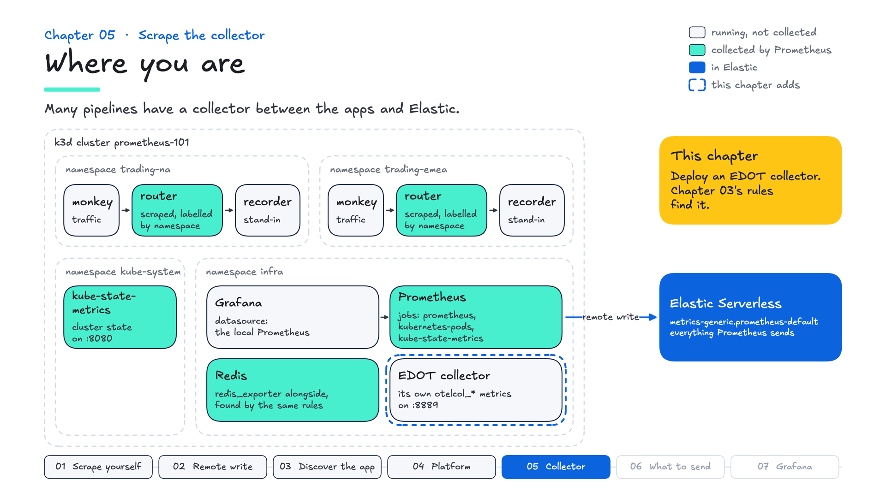
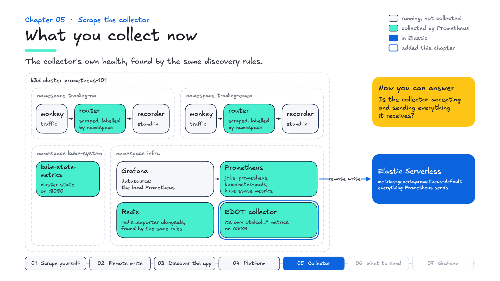

# Chapter 05 — Scrape the collector

**Goal:** deploy an OpenTelemetry collector, watch chapter 03's rules find it with no config change, and check that it isn't dropping data.

**Time:** 5 minutes

## Why it matters

Many pipelines have a collector between the apps and the backend, and when telemetry goes missing the first question is whether the collector dropped it. A collector can serve its own counters on a Prometheus endpoint, and the discovery rules you already wrote find it like any other workload: one way of monitoring the pipeline and the apps, not two.



## Steps at a glance

1. Start the chapter: `make chapter 5`
2. Deploy a collector: `make collector`
3. See it: the Targets page, with no config change
4. Check it isn't dropping data: accepted minus sent, in Kibana
5. Grade it: `make test`

## Step 1 · Start the chapter

```bash
make chapter 5
```

## Step 2 · Deploy a collector

```bash
make collector
```

This deploys one EDOT collector, on the same image superdemo runs (`elastic-agent:9.5.0`, invoked as `elastic-agent otel`).

## Step 3 · See it on the Targets page

You should see a fourth target in the `kubernetes-pods` job, the collector, **UP**. You changed no config. Its manifest carries the same two annotations as everything else, and its config serves its own metrics in Prometheus format on port 8889, so chapter 03's rules found it.

<details>
<summary>Note · What gives the collector a metrics endpoint</summary>

This is the reader in `agents/apm/local.yaml`:

```yaml
    service:
      telemetry:
        metrics:
          readers:
            - pull:
                exporter:
                  prometheus:
                    host: 0.0.0.0
                    port: 8889
```

A `pull` reader serves the collector's own metrics in Prometheus format, on a port, for anything to scrape. A `periodic` reader would push them over OTLP instead, which is what superdemo's collectors do, to a gateway.

It uses port **8889**, not the usual 8888. A collector that runs with `hostNetwork: true`, as node-level collectors often do, binds its ports on the node itself, so two collectors on one node cannot both have 8888.

</details>

## Step 4 · Check it isn't dropping data

In Kibana:

```esql
PROMQL index=metrics-generic.prometheus-default step=1m
  sum(rate(otelcol_receiver_accepted_metric_points[5m]))
  - sum(rate(otelcol_exporter_sent_metric_points[5m]))
```

You should see a line near zero. What came in, minus what went out, is the conservation check for any stage that should pass everything through, and a line that stays above zero is the alert. The chart is empty for the first half-minute, because `rate` needs two scrapes.

<details>
<summary>Note · The four counters that matter</summary>

```promql
otelcol_receiver_accepted_metric_points     # came in
otelcol_receiver_refused_metric_points      # came in and was rejected
otelcol_exporter_sent_metric_points         # went out
otelcol_exporter_send_failed_metric_points  # tried to go out and failed
```

The last one may not exist at all. The collector creates some counters lazily, and `send_failed` is **absent, not zero**, until a send first fails, so a query for it returns no results. An alert written as `send_failed > 0` is fine; one that expects the series to exist never fires.

If you run these in the Prometheus expression browser, it may show a *Query notice* that the metric "might not be a counter". It is one. Prometheus guesses from a `_total` suffix, and these names don't have one. Elasticsearch guesses from the suffix too, and stores them as gauges. PromQL's `rate()` works on them in both places, but ES|QL's own `RATE()` would refuse them. Names are an interface.

</details>

<details>
<summary>Note · A collector can be a Prometheus, too</summary>

`agents/apm/local.yaml` also has this collector scraping the routers:

```yaml
    receivers:
      prometheus:
        config:
          scrape_configs:
            - job_name: router-via-otel
              static_configs:
                - targets:
                    - router.trading-na.svc.cluster.local:9000
                    - router.trading-emea.svc.cluster.local:9000
```

That gives two ways to get the router's metrics into Elastic:

| | Path | Lands in |
|---|---|---|
| What you built | router → Prometheus → remote write | `metrics-generic.prometheus-default` |
| A collector as the scraper | router → collector → OTLP | `metrics-prometheusreceiver.otel-default` |

Here the receiver exports to `debug`, so only the first path writes to Elastic. Neither is wrong. Both land in time series data streams that PromQL in Kibana can read, but with different field names. Choose one path per metric, because running both sends the same data twice, in two shapes.

</details>

## Step 5 · Grade it

```bash
make test
```

You should see every check pass: the collector found by the same rules, its `otelcol_*` metrics scraped, and accepted minus sent answering in Kibana.

## The whole change

No file changes. The commands, in order:

```bash
make chapter 5
make collector
make test
```

## Say it

"Your collectors report what they receive and what they send. Put those counters next to everything else, and 'did we lose data?' is a query, not a guess."



<details>
<summary>Note · In the field</summary>

- **Ask:** "Do you run collectors between your apps and your backend, and who watches them?" and "Are you standardising on Prometheus, OpenTelemetry, or both?"
- **If they say** "Should our Prometheus metrics come through remote write or a collector?": both work, and they land with different field shapes. Pick one path per metric, so the same data doesn't arrive twice, and prefer the one their teams already operate.
- **Good practice:** treat collectors as part of the pipeline you monitor. Alert on refused and failed points, and on accepted minus sent staying above zero.
- **In superdemo:** the EDOT collectors in `agents/apm/` run in three tiers, and each reports the same `otelcol_*` counters, over OTLP to a gateway.

</details>

Next: choose what to send.
