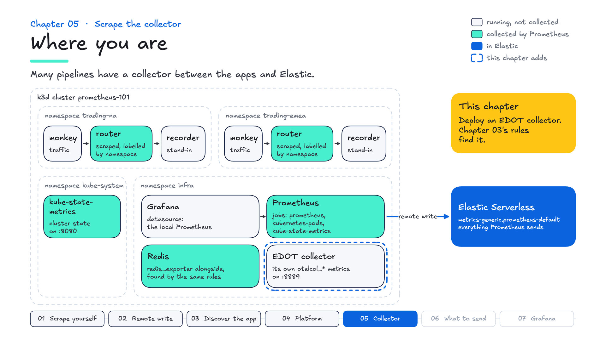
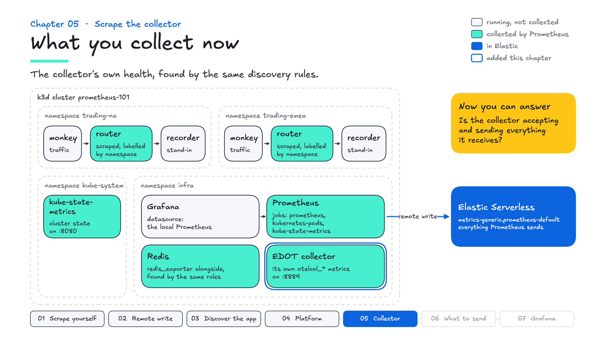

# Chapter 05 — Scrape the collector

**Goal:** scrape an OpenTelemetry collector's own metrics, so you can tell whether it is dropping data.

---

## Where you are

Prometheus collects the app, Redis and the cluster's state. Between apps and Elastic there is often an OpenTelemetry collector, and collectors report on their own health. This chapter deploys one and lets chapter 03's rules scrape it.



Grade it before you start:

```bash
make test
```

Chapters 01 to 04 pass. Chapter 05's first check fails: there is no collector yet.

---

## The idea

Between your apps and Elastic there is often a collector, and when telemetry goes missing someone will ask: **is the collector dropping it?**

The collector can answer that itself. It counts what it receives, refuses, sends and fails to send, and where those counts go is configuration. superdemo's collectors send theirs over OTLP to a gateway. Here you give one collector a Prometheus endpoint instead, and let chapter 03's rules find it.

---

## Deploy a collector

```bash
make collector
```

One collector, on the same image superdemo runs (`elastic-agent:9.5.0`, invoked as `elastic-agent otel`).

Look at the Targets page. **It is already there** — chapter 03's rules found it, because the manifest carries the same two annotations everything else does. Third workload, still zero scrape config.

---

## What made it visible

The annotations, and the reader in this repo's `agents/apm/local.yaml` that gives them something to point at:

```yaml
    service:
      telemetry:
        metrics:
          readers:
            - pull:
                exporter:
                  prometheus:
                    host: 0.0.0.0
                    port: 8889
```

A `pull` reader: the collector serves its own metrics in Prometheus format, on a port, for anything to scrape. A `periodic` reader would push them over OTLP instead.

Port **8889**, not the usual 8888. A collector that runs with `hostNetwork: true`, as node-level collectors often do, binds its ports on the node itself, so two collectors on one node cannot both have 8888.

---

## The four metrics that matter

```promql
otelcol_receiver_accepted_metric_points     # came in
otelcol_receiver_refused_metric_points      # came in and was rejected
otelcol_exporter_sent_metric_points         # went out
otelcol_exporter_send_failed_metric_points  # tried to go out and failed
```

Read them as a pipeline: `accepted` minus `sent` is data that entered and did not leave — buffering, a processor dropping it, or a broken exporter.

```promql
  sum(rate(otelcol_receiver_accepted_metric_points[5m]))
- sum(rate(otelcol_exporter_sent_metric_points[5m]))
```

Near zero in a healthy collector. (Empty straight after `make collector`: `rate` needs two scrapes, so give it half a minute.)

Prometheus may also show two yellow *Query notice* boxes saying the metric "might not be a counter". It is one, as its metadata says: Prometheus guesses from a `_total` suffix, and these names do not have one. The notice is a guess, not an error, and the number under it is right.

**One thing that surprises people:** `otelcol_exporter_send_failed_metric_points` may not exist at all. The collector creates some counters lazily, and this one is **absent, not zero**, until a send first fails. (Others, such as `otelcol_receiver_refused_metric_points`, appear at 0 from the start.) An empty result means "this has never happened", which is the answer you wanted but not the answer PromQL appears to give.

---

## The other half: the collector as a Prometheus

Look at what else `agents/apm/local.yaml` has this collector doing:

```yaml
    receivers:
      prometheus:
        config:
          scrape_configs:
            - job_name: router-via-otel
              static_configs:
                - targets:
                    - router.trading-na.svc.cluster.local:9000
                    - router.trading-emea.svc.cluster.local:9000
```

It is scraping the router. A collector with a `prometheus` receiver **is** a Prometheus for collection purposes.

That gives you two ways to get the router's metrics into Elastic:

| | Path | Lands in |
|---|---|---|
| What you built | router → Prometheus → remote write | `metrics-generic.prometheus-default` |
| A collector as the scraper | router → collector → OTLP | `metrics-prometheusreceiver.otel-default` |

Here the collector's receiver exports to `debug`, so only the first one writes to Elastic.

Neither is wrong. Remote write gives you `metrics.*` / `labels.*`; OTLP gives you the OTel field model and everything else the collector can do on the way through. Both land in time series data streams that the `_prometheus` query API can read, but the same metric has different field names on each path. Choose one path per metric: running both sends the same data twice, in two shapes.

---

## Grade it

```bash
make test
```

Chapter 05's checks: the collector is deployed; it was found by the same annotation rules, with no config change; its `otelcol_*` metrics are being scraped, including accepted and sent points and its memory; and it is accepting data.

## What you collect now



## In the field

- **In superdemo:** the EDOT collectors in `agents/apm/` run in three tiers, and each reports the same `otelcol_*` counters. There they go over OTLP to a gateway, not to a Prometheus endpoint.
- **What customers ask:** "Should our Prometheus metrics come in through remote write or a collector?" Both work, and they land with different field shapes. Pick one path per metric, so the same data doesn't arrive twice.
- **Good practice:** treat collectors as part of the pipeline you monitor: alert on refused and failed points, and on accepted minus sent staying above zero.

## What you now know


| | |
|---|---|
| **Collectors are scrape targets** | once a `pull` reader gives them an endpoint |
| **`pull` vs `periodic` readers** | Prometheus format on a port, or OTLP to a gateway |
| **The four counters** | accepted / refused / sent / send_failed, read as a pipeline |
| **Lazy metric creation** | `send_failed` is absent, not zero, until a send first fails |
| **`hostNetwork`** | a port you bind is a port on the node |
| **A collector can be a Prometheus** | a `prometheus` receiver scrapes, then exports over OTLP |

Next: choosing what to send.
