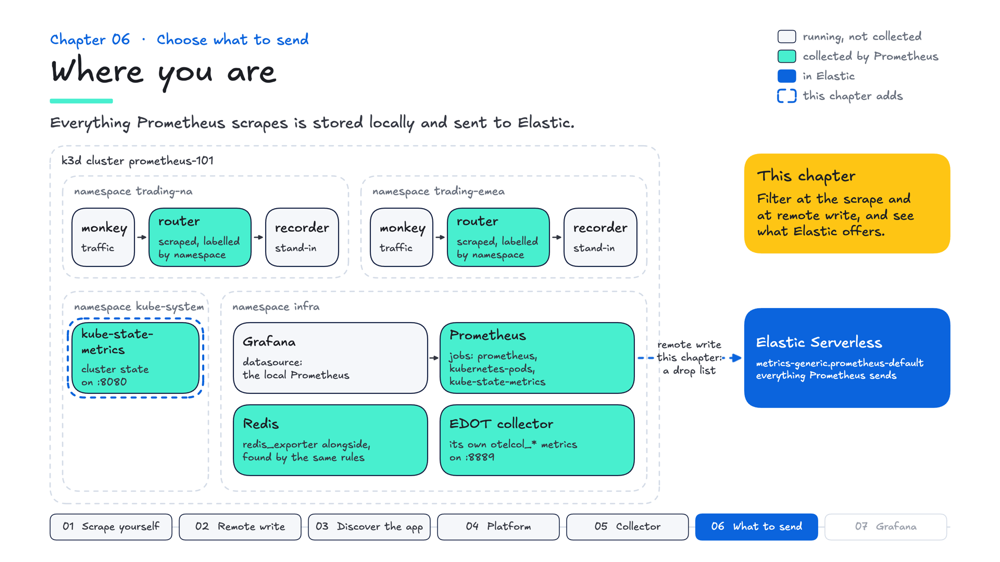
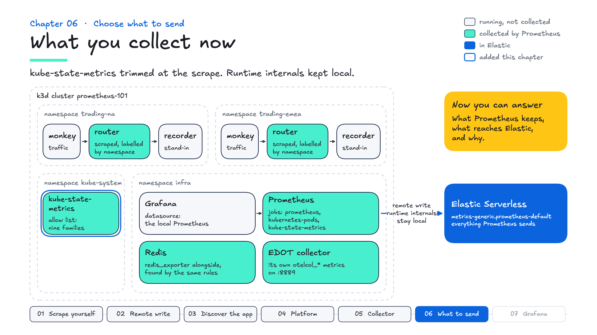

# Chapter 06 — Choose what to send

**Goal:** filter series at the scrape and at remote write, and know which choice fits which data.

**Time:** 7 minutes

## Why it matters

Series count drives cost and performance everywhere metrics live, and it grows with the cluster, often from metrics nobody queries. Prometheus can filter before it stores a series and before it sends one, and Elastic adds retention and downsampling, so the customer decides what is kept where, and for how long.



## Steps at a glance

1. Start the chapter: `make chapter 6`
2. See which job sends the most, in Kibana
3. Keep only the kube-state-metrics families you use: an allow list at the scrape
4. Keep the router's runtime metrics out of Elastic: a drop list at remote write
5. Apply both: `make apply`
6. See it: kept per job, and the same metric in Prometheus and in Kibana
7. Grade it: `make test`

## Step 1 · Start the chapter

```bash
make chapter 6
```

## Step 2 · See which job sends the most

In Kibana:

```esql
PROMQL index=metrics-generic.prometheus-default time=?_tend
  sum by (job) (scrape_samples_scraped)
```

You should see `kube-state-metrics` far ahead, at about 1,300. It describes every pod, deployment and node, so its count follows the cluster rather than your application.

There are four places to decide what is kept:

| | Where | What it does |
|---|---|---|
| `metric_relabel_configs` | under a scrape job | filters after the scrape: the series isn't stored anywhere |
| `write_relabel_configs` | under `remote_write` | filters before sending: kept in Prometheus, not sent to Elastic |
| Retention | per data stream, in Elastic | how long Elastic keeps what arrives |
| Downsampling | per data stream, in Elastic | older data kept at a coarser resolution |

For each group of series, ask **who uses it, and for how long?** Nobody: don't collect it. Only someone debugging this cluster: keep it local. Dashboards and alerts: send it, and let Elastic handle its age.

<details>
<summary>Note · Retention and downsampling in Elastic</summary>

Elastic stores remote write in a time series data stream. Retention is set per data stream, and a time series data stream can be downsampled as it ages: full resolution for recent data, fewer points per series for older data. Elastic measured a [94% storage reduction](https://www.elastic.co/search-labs/blog/elasticsearch-downsampling-methods-esql) on its OpenTelemetry benchmark, and ES|QL dashboards built on the raw data run unchanged on the downsampled data. To give teams or clusters their own retention, route them to their own data streams with chapter 02's path form.

Many teams start by sending everything and trim once they see what is used. Others start from an allow list. Either works, as long as the choice is deliberate and revisited.

</details>

## Step 3 · Allow list at the scrape

kube-state-metrics exposes more than 90 metric families, and this course uses a handful. In `prometheus/prometheus.yml`, add this to the `kube-state-metrics` job, after its `relabel_configs`:

```yaml
    metric_relabel_configs:
      - source_labels: [__name__]
        action: keep
        regex: kube_(pod_status_phase|pod_container_status_restarts_total|deployment_status_replicas.*|node_status_condition|namespace_created|daemonset_status_number_ready)
```

An allow list is safe here because this job holds one kind of target. `metric_relabel_configs` applies to every target in its job, so the same list in `kubernetes-pods` would drop the trading app's metrics too.

<details>
<summary>Note · Regexes are anchored</summary>

Prometheus wraps every relabel regex as `^(?s:...)$`, anchored at both ends. So `regex: nodejs_heap` matches nothing, because the metric is `nodejs_heap_size_total_bytes`. The config is valid, `promtool` passes it, and no log line mentions it: a rule that matches nothing looks like a rule that isn't there.

PromQL's `=~` is anchored the same way, so in the Prometheus expression browser this lists exactly what a rule with the same regex would match:

```promql
count by (__name__) ({__name__=~"nodejs_.*"})
```

Breadth matters the other way too. A pattern like `.*_total` would also drop `http_requests_total`, the application's request counter, while remote write reported success throughout.

</details>

## Step 4 · Drop list at remote write

The router's Node.js client exposes runtime internals with every scrape: heap, garbage collection, the event loop. They help someone debugging the router live, and a team may not need them in Elastic. Add this under the `remote_write` block, after `queue_config`:

```yaml
    write_relabel_configs:
      - action: drop
        source_labels: [__name__]
        regex: nodejs_.*|process_.*

      - action: drop
        source_labels: [__name__]
        regex: go_.*|promhttp_.*
```

This is a **drop list**: send everything except these families. A family the app adds later still arrives, rather than being filtered out without anyone noticing.

<details>
<summary>Note · Why a drop list, not "keep everything except"</summary>

A single `keep` rule can't say "everything except", because Prometheus regexes are RE2, which has no negative lookahead. A drop list says it directly.

</details>

## Step 5 · Apply both

```bash
make apply
```

## Step 6 · See it

Give it a minute, then compare what each job kept with what it scraped:

```esql
PROMQL index=metrics-generic.prometheus-default time=?_tend
  sum by (job) (scrape_samples_post_metric_relabeling)
```

You should see `kube-state-metrics` at about **186**, down from about 1,300: nine metric families instead of more than 90, and every chapter 04 query still works.

Now ask both sides the same question. In Prometheus, `nodejs_heap_size_total_bytes` is still there, for whoever debugs the router live. In Kibana:

```esql
PROMQL index=metrics-generic.prometheus-default step=1m
  nodejs_heap_size_total_bytes
```

You should see the line **stop** about a minute after your `make apply`: kept in Prometheus, not sent to Elastic. Filtering changes new data only. What already arrived stays until retention removes it.

## Step 7 · Grade it

```bash
make test
```

You should see every check pass: kube-state-metrics trimmed and still answering, `nodejs_*` in Prometheus but no longer reaching Elastic, and the app's own metrics still arriving. Run it at least a minute after `make apply`.

## The whole change

In `prometheus/prometheus.yml`, in the `kube-state-metrics` job, after its `relabel_configs`:

```yaml
    metric_relabel_configs:
      - source_labels: [__name__]
        action: keep
        regex: kube_(pod_status_phase|pod_container_status_restarts_total|deployment_status_replicas.*|node_status_condition|namespace_created|daemonset_status_number_ready)
```

In the `remote_write` block, after `queue_config`:

```yaml
    write_relabel_configs:
      - action: drop
        source_labels: [__name__]
        regex: nodejs_.*|process_.*

      - action: drop
        source_labels: [__name__]
        regex: go_.*|promhttp_.*
```

The commands, in order:

```bash
make chapter 6
make apply
make test
```

## Say it

"You decide what's kept, where and for how long. Filter what nobody uses at the scrape, keep debug detail local, send what dashboards and alerts need, and let retention and downsampling handle its age."



<details>
<summary>Note · In the field</summary>

- **Ask:** "Which metrics do your dashboards and alerts actually use?" and "How long do you need full resolution, and how long do you need trends?"
- **If they say** "We'll just send everything": that's a reasonable start. Ask who reviews it in three months. The series count per job (Step 2's query) is the number to watch.
- **Watch for labels:** a label that holds a user ID or request ID multiplies series. Drop or rewrite that label (`action: labeldrop`) rather than the whole metric.
- **In practice,** build the allow list from what dashboards and alerts query. A customer may well keep a broader set, and that's a reasonable choice too.
- **In superdemo:** its Prometheus sends everything it scrapes, which suits a demo. If a customer asks how to control volume, an allow list goes under any scrape job in its `prometheus.yml`, and a drop list under its `remote_write`, as here.

</details>

Next: Grafana, pointed at Elastic.
