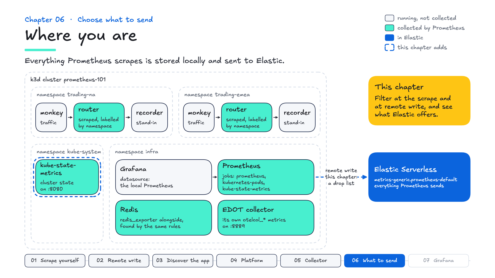
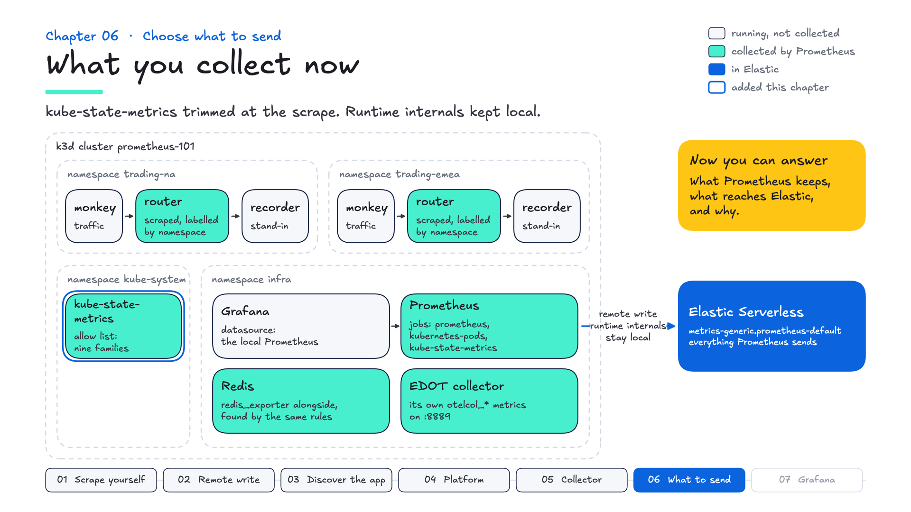

# Chapter 06 — Choose what to send

**Goal:** learn the two places Prometheus can filter series, what Elastic gives you for managing what it stores, and how to help a customer decide which to use.

---

## Where you are

Prometheus scrapes itself, both routers, Redis, kube-state-metrics and the collector, and it sends everything it scrapes to Elastic. This chapter adds two filters, one at the scrape and one at remote write, and looks at the controls on the Elastic side.



Grade it before you start:

```bash
make test
```

Chapters 01 to 05 pass. Two of chapter 06's checks fail, and they describe where you are going: kube-state-metrics trimmed to the families you use, and the router's runtime metrics kept in Prometheus but no longer sent to Elastic. The other three already pass, and should keep passing as you filter: the families you keep still answer queries, the runtime metrics stay in Prometheus, and the application's own metrics keep arriving in Elastic. The two failing checks each wait a few minutes before they give up, so this run is slow.

---

## How many series you have

Chapter 01 asked you to note this number:

```promql
prometheus_tsdb_head_series
```

It counts the distinct series Prometheus holds in memory, and everything you have added since is in it. Now see which job contributes the most:

```promql
topk(5, count by (job) (last_over_time({__name__=~".+"}[1m])))
```

kube-state-metrics is the largest by far. It describes every pod, deployment and node, so its count follows the size of the cluster rather than your application.

Series count is the number to watch on both sides. In Prometheus it drives memory. In Elastic it drives how much is indexed and stored.

---

## Choices on both sides

Before you filter anything, know what each side offers.

| | Where | What it does |
|---|---|---|
| `metric_relabel_configs` | under a scrape job | filters after the scrape, before local storage: the series is not kept anywhere |
| `write_relabel_configs` | under `remote_write` | filters before sending: kept in Prometheus, not sent to Elastic |
| Retention | per data stream, in Elastic | how long Elastic keeps what arrives |
| Downsampling | per data stream, in Elastic | older data kept at a coarser resolution |

Elastic stores remote write in a **time series data stream**, which is built for this shape of data. Retention is set per data stream, and a time series data stream can be downsampled as it ages: full resolution for recent data, fewer points per series for older data.

A useful question for each group of series is **who uses it, and for how long?**

- **Nobody, anywhere:** don't collect it. Filter at the scrape.
- **Only someone debugging this cluster right now:** keep it in Prometheus, and don't send it.
- **Dashboards, alerts, investigations, trends:** send it, and let retention and downsampling in Elastic handle its age.


Many teams start by sending everything and trim once they see what is used. Others start from an allow list. Either works, as long as the choice is deliberate and revisited.

---

## An allow list, at the scrape

kube-state-metrics exposes more than 90 metric families, and this course's queries use a handful. Keep those, at the scrape, with an **allow list** in the kube-state-metrics job:

```yaml
    metric_relabel_configs:
      - source_labels: [__name__]
        action: keep
        regex: kube_(pod_status_phase|pod_container_status_restarts_total|deployment_status_replicas.*|node_status_condition|namespace_created|daemonset_status_number_ready)
```

```bash
make apply
```

```promql
count(last_over_time({__name__=~"kube_.*"}[1m]))
```

Give it a minute: the `[1m]` window still holds the last scrape before your change. Then about **186**, from about **1,300**: nine metric families instead of more than 90, and every chapter 04 query still works. The 186 stays put as the cluster grows, because your list sets it.

An allow list is safe here because this job holds one kind of target. `metric_relabel_configs` applies to every target in its job, so the same list in `kubernetes-pods` would drop the trading app's metrics too. That is one reason chapter 04 gave kube-state-metrics a job of its own: when a rule is hard to write for a job, its targets often belong in separate jobs.

In practice, build the list from what dashboards and alerts query. A customer may well keep a broader set, and that is a reasonable choice too.

---

## A drop list, at remote write

The router's Node.js client exposes runtime internals with every scrape: heap, garbage collection, the event loop. They help when someone is debugging the router live, and a team may not need them in Elastic. Drop them at remote write, under the `remote_write` block, so Prometheus keeps them:

```yaml
    write_relabel_configs:
      - action: drop
        source_labels: [__name__]
        regex: nodejs_.*|process_.*

      - action: drop
        source_labels: [__name__]
        regex: go_.*|promhttp_.*
```

```bash
make apply
```

This is a **drop list**: send everything except these families. A single `keep` rule can't say "everything except", because Prometheus regexes are RE2, which has no negative lookahead. A drop list also means a family the app adds later still arrives, instead of being filtered out without anyone noticing.

---

## Regexes are anchored

Prometheus wraps every relabel regex as `^(?s:...)$`: anchored at both ends. So this:

```yaml
        regex: nodejs_heap
```

matches nothing, because the metric is `nodejs_heap_size_total_bytes`. The config is valid, `promtool` passes it, and no log line mentions it. **A rule that matches nothing looks like a rule that isn't there.**

Check what a pattern matches before you rely on it. PromQL's `=~` is anchored the same way, so this lists exactly what a rule with the same regex would drop:

```promql
count by (__name__) ({__name__=~"nodejs_.*"})
```

Breadth matters the other way too. A pattern like `.*_total` would also drop `http_requests_total`, the application's request counter, and remote write would report success throughout. That is why the grader checks the application's metrics are still arriving.

---

## Grade it

Prometheus still has the runtime metrics:

```promql
nodejs_heap_size_total_bytes
```

```bash
make test
```

Chapter 06's checks:

- kube-state-metrics is down to the families you kept, and they still answer questions.
- `nodejs_*` is still in Prometheus.
- `nodejs_*` has stopped reaching Elastic: no new samples in the last minute.
- The application's own metrics are still arriving in Elastic.

The same rule gives two answers: in Prometheus, and not in Elastic. Filtering changes new data only. What already reached Elastic stays until the data stream's retention removes it.

---

## What you collect now



## In the field

- **In superdemo:** its Prometheus sends everything it scrapes, which suits a demo. If a customer asks how to control volume, an allow list goes under any scrape job in its `prometheus.yml`, and a drop list under its `remote_write`, as here.
- **What customers ask:** "How do we keep metric volume under control?" Start from what they use: dashboards, alerts, SLOs, investigations. Then walk through the four controls: filter at the scrape, filter at remote write, retention per data stream, and downsampling.
- **Watch for labels:** a label that holds a user ID or request ID multiplies series. Drop or rewrite that label (`action: labeldrop`) rather than the whole metric.
- **Tailor it:** route teams or clusters to their own data streams with chapter 02's path form, so each can have its own retention.

## What you now know

| | |
|---|---|
| **`metric_relabel_configs`** | filter at the scrape: the series isn't stored anywhere |
| **`write_relabel_configs`** | filter at remote write: kept locally, not sent |
| **Retention and downsampling** | set per data stream in Elastic |
| **Allow lists suit one kind of target** | which is why kube-state-metrics has its own job |
| **Drop lists let new families through** | nothing disappears unnoticed |
| **Anchored regexes** | `nodejs_heap` doesn't match `nodejs_heap_size_total_bytes` |
| **Filtering changes new data** | stored data follows retention |

Next: Grafana, pointed at Elastic.
