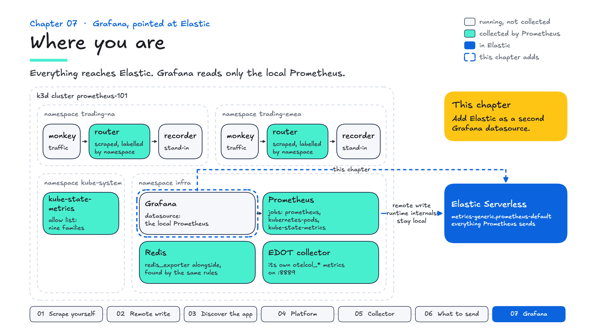
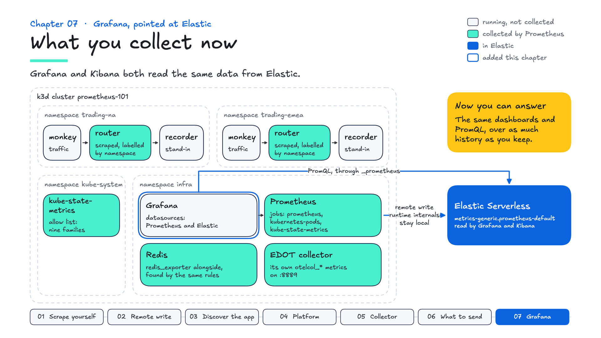

# Chapter 07 — Grafana, pointed at Elastic

**Goal:** add Elastic to Grafana as a second datasource, so existing dashboards and PromQL can read from Elastic, then keep the same queries in Kibana as a dashboard.

## Why it matters

- **The problem:** teams that run Prometheus have years of Grafana dashboards, alerts and PromQL habits. A change of backend that means rebuilding them all is a project nobody wants to sign up for.
- **What Prometheus does:** its HTTP API is a de facto standard. Anything that speaks it, Elasticsearch included, can sit behind a Grafana `prometheus` datasource.
- **Why it's worth it:** it's "and", not "or". Grafana keeps its dashboards and gains retention and a view across clusters; Kibana runs the same PromQL next to logs and traces. The customer moves at their own pace, and their PromQL skills carry over.

---

## Where you are

Everything you collect reaches Elastic. Grafana, in `infra`, reads only the local Prometheus, which holds about six hours. This chapter adds Elastic as a second Grafana datasource, then keeps the same queries in Kibana.



```bash
make goals
```

Chapters 01 to 06 pass. Chapter 07's are to do: Grafana has one datasource, not two.

---

## The idea

The first question from most teams that already run Prometheus:

> "So I have to rebuild my dashboards?"

Often not. Elasticsearch exposes a **Prometheus-compatible read API**: point Grafana at it as a `type: prometheus` datasource, and Grafana queries it the same way it queries Prometheus. From `superdemo/utils/prometheus-grafana/grafana.yaml`, trimmed:

```yaml
datasources:
  - name: Prometheus
    type: prometheus
    url: http://prometheus.infra.svc.cluster.local:9090

  - name: Elasticsearch
    type: prometheus                                    # <- both are prometheus
    url: "$elasticsearch_es_endpoint/_prometheus/metrics-generic.prometheus-default"
    isDefault: true
    jsonData:
      httpMethod: GET
      httpHeaderName1: "Authorization"
    secureJsonData:
      httpHeaderValue1: "ApiKey $elasticsearch_api_key"
```

Two datasources, **both `type: prometheus`**. One is a real Prometheus, one is Elasticsearch, and Grafana talks to both the same way. The whole change fits on one screen. Note the URL carries the data stream — the read side of the endpoint you have been writing to since chapter 02.

This workshop's copy, in `utils/prometheus-grafana/grafana.yaml`, is the same pair, with the second one named `Elastic` and its URL filled in from your `.env`. It sets `httpMethod: GET`, as superdemo does; that is the setting this course was tested with.

---

## Do it

**▶ Your turn:**

```bash
make grafana
```

Grafana starts with one datasource, the local Prometheus. `make grafana` adds the Elastic one: `build.sh` renders it, substituting `$ELASTIC_ES_URL`, `$DATA_STREAM` and `$ELASTIC_API_KEY`, and restarts Grafana so it reads the new list. Open Grafana (`make check` prints the URL) → **Connections → Data sources**. Two entries, both Prometheus.

## Prove it

Explore, pick **Elastic**, and run PromQL:

```promql
up
sum(rate(http_requests_total[5m])) by (region)
histogram_quantile(0.95, sum(rate(http_request_duration_seconds_bucket[5m])) by (le, region))
```

The last one is worth pausing on: a histogram quantile, computed by Elasticsearch, answered through the Prometheus API, rendered by Grafana. Nothing in that sentence required rebuilding a dashboard.

Switch the dropdown to **Prometheus** and run it again. Same shape, different source; the panel does not care.

And the same question in Kibana, chapter 03's query:

```esql
PROMQL index=metrics-generic.prometheus-default step=1m
  histogram_quantile(0.95, sum by (le, region) (rate(http_request_duration_seconds_bucket[5m])))
```

Three front ends: Grafana's Prometheus datasource reads the local copy, and the other two read Elastic's. **The difference to point out:** this Prometheus keeps six hours; Elastic keeps what the data stream's retention says. Longer history, across clusters and next to logs and traces, is one of the main reasons teams centralise.

---

## What carries over, and what doesn't

Be precise with customers. Elasticsearch implements a **subset** of the Prometheus HTTP API, and of PromQL. Measured on this course's Serverless project:

- **Through Grafana:** instant and range queries, label values, series and metadata all answer, so template variables such as `label_values(redis_up, instance)` work. **Exemplars** do not: `/api/v1/query_exemplars` has no handler, so a panel that overlays exemplars on a histogram shows the histogram without them.
- **In Kibana's `PROMQL`** (31 October 2026): every query in this course runs except four kinds.
  - `absent()` is not implemented, and `absent_over_time` on a metric that has never existed doesn't behave as it does in Prometheus.
  - Metric-name patterns such as `{__name__=~"kube_.*"}` are rejected.
  - `label_replace` works only inside a `by()`.
  - Dividing two different metrics needs both sides aggregated by the labels they match on, as chapter 04's replica query does.

  Beyond this course: `and`, `unless`, `on`, `ignoring`, `group_left`, `@` and subqueries return an error today. Kubernetes dashboards often join series with `group_left`, so test those first.

  Elastic's [PromQL limitations page](https://www.elastic.co/docs/reference/query-languages/promql/promql-limitations) lists the rest, and the list is getting shorter.

One difference is not an error. A Grafana variable lists every value inside the time range you ask for, and Elastic can answer for a far longer range than Prometheus — so a variable can offer pods that are long gone. That is the retention argument, turning up in a dropdown.

What held up here: **the course's queries, panels and template variables worked through Elastic; exemplars did not.** Test a customer's own dashboards before you promise more than that.

---

## Keep it in Kibana

Many teams keep Grafana. Others want their metrics where their logs and traces already are. Either way, the queries you wrote work in Kibana.

**▶ Your turn:** in Discover, run chapter 03's requests per region:

```esql
PROMQL index=metrics-generic.prometheus-default step=1m
  sum by (region) (rate(http_requests_total[5m]))
```

Then **Save visualization to dashboard** (the save icon above the chart), into a new dashboard. Add the p95 query the same way. That is a Kibana dashboard written entirely in PromQL, over as much history as the data stream keeps.

superdemo ships a saved search built on the same data stream. Import it:

```bash
make import
```

```
OK:   Imported 2 saved object(s).
       tag  metrics
       search  Prometheus

  open: https://<your-kibana>/app/discover#/view/<id>
```

Follow the `open:` link. It is superdemo's `assets/objects/metrics_esql.ndjson`, imported **unmodified**, because you have been writing to the data stream it reads:

| Tab | Query | Against your data |
|---|---|---|
| `node.js prom (remote_write)` | `TS metrics-generic.prometheus-default` | works — what chapter 02 built |
| `PROMQL` | `PROMQL index=metrics-* … sum by (region) (rate(metrics.http_requests_total[5m]))` | works, and groups by `region`, which has a value once chapter 03 scrapes the routers |

Its third tab reads `metrics-prometheusreceiver.otel-default`, the collector-as-scraper path from chapter 05. Your collector exports to `debug`, so that tab stays empty. **If you share a project with other demos**, that data stream is not course-specific and may already hold unrelated data; check the timestamps.

PromQL is one way into this data. ES|QL's `TS` command is the other, and it's the one you extend with joins and lookups:

```bash
make esql Q=queries/esql/07-requests-by-region-ts.esql
```

The same requests per region, as `SUM(RATE(...)) BY region, TBUCKET(1 minute)`.

---

## Grade it

```bash
make test
```

Chapter 07's checks: Grafana is deployed with two datasources, both `type: prometheus`; one points at Elasticsearch's `_prometheus` endpoint; and it answers a PromQL query through Grafana's proxy, the whole path a dashboard uses, not just that the config exists.

## What you collect now



## In the field

- **Say it:** "Keep Grafana: add Elastic as a Prometheus datasource, and the PromQL in your dashboards runs against it. Let's test your top five together. The same PromQL runs in Kibana, next to your logs and traces, over as much history as you keep."
- **Ask:** "Which five dashboards would you test first?" and "Do any of them use exemplars, or functions beyond the basics?"
- **If they say** "Do we have to rebuild our dashboards?": often not. Test their most important ones through the Elastic datasource, and be precise about the gaps above. Elastic's migration tool, [GA in 9.5](https://www.elastic.co/blog/whats-new-elastic-9-5-0), brings Grafana dashboards and alerts into Kibana; test what it converts, as you would the datasource.
- **Tailor it:** the datasource URL names a data stream or a pattern: `metrics-*.prometheus-*` reads every Prometheus data stream through one datasource.
- **Keep the key in a Secret:** here, as in superdemo, the API key is written into Grafana's datasource ConfigMap, which is fine for a lab. In a customer's cluster, put it in a Secret, give it to Grafana as an environment variable, and reference that variable in `secureJsonData`: Grafana expands environment variables in provisioning files.
- **In superdemo:** Grafana has the same two datasources, and Kibana has the saved search you imported, with its PromQL tab. Those are the two places to show this chapter's outcome.

**Explain it back:** a customer has 200 Grafana dashboards. What do you tell them carries over, what doesn't, and how would you prove it?

## What you now know


| | |
|---|---|
| **`type: prometheus` twice** | Elasticsearch's read API speaks the Prometheus HTTP API |
| **Above the datasource** | the course's queries and template variables worked unchanged |
| **`PROMQL` in Kibana** | the same queries, saved to a dashboard; a few functions still missing |
| **Retention** | six hours here; Elastic keeps what each data stream's retention says |
| **A subset of the API** | test exemplars, and a customer's own dashboards |
| **superdemo's saved search** | works against your data unmodified |

That is the workshop. You can now explain what each piece of a Prometheus setup does, why a customer would invest in it, and how the same PromQL works in Kibana. `docs/FIELD-GUIDE.md` collects the talk tracks, questions and a five-minute demo.

When you open superdemo next, `docs/SUPERDEMO-MAP.md` shows where each piece you built lives there.
